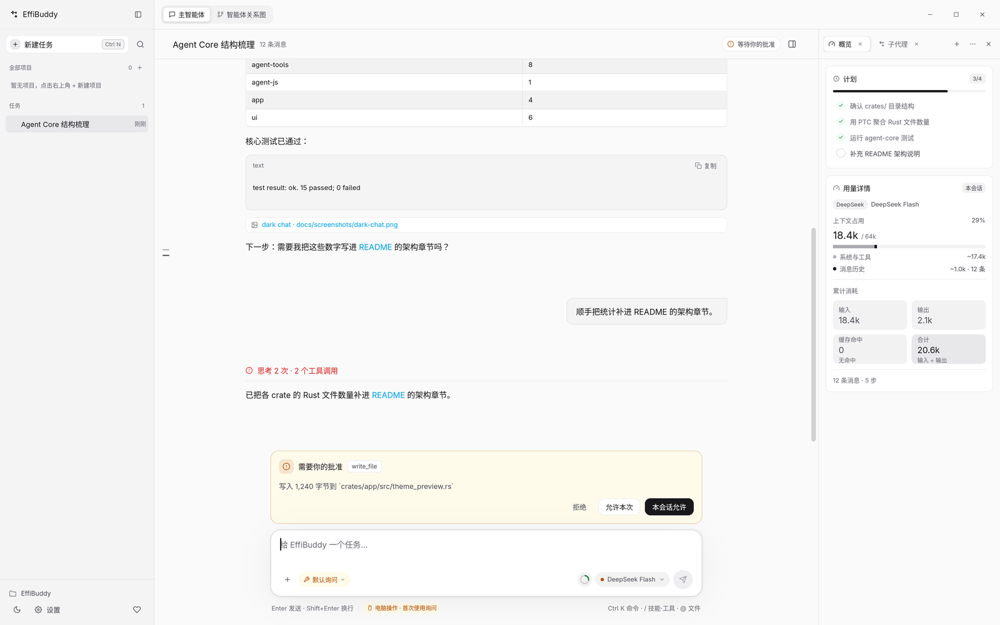
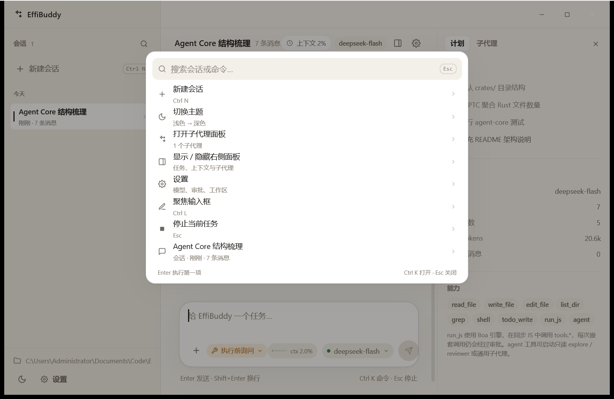

# EffiBuddy

**用 Rust + GPUI 从零搭建的本地优先桌面 Agent。** 原生窗口、流式对话、工具循环，以及基于 [Boa](https://github.com/boa-dev/boa)（纯 Rust JavaScript 引擎）的 **PTC（Programmatic Tool Calling）** 工具编排。


界面采用中性的 **White / Gray / Black** 设计系统：近白底色、灰色侧栏与卡片层次、墨黑强调色、细线边框，并提供对应的暗色主题。

> 注：仓库内截图拍摄于旧版暖纸配色，当前版本已切换为中性白灰黑；截图待更新。

<details>
<summary>更多截图</summary>

| 深色主题 | 工具审批 |
| --- | --- |
|  |  |

| 空状态 | 命令面板 |
| --- | --- |
|  |  |

| 子代理面板 | 只读子会话 |
| --- | --- |
|  |  |

</details>

## 亮点

- **原生桌面 UI（GPUI）**：无 WebView。自绘标题栏、可折叠（`Ctrl+B`）为图标栏的会话侧栏、聊天流、紧凑工具行、可关闭/重开/搜索的右侧页签侧栏、设置页、Markdown 渲染、多行输入框与 IME 支持。
- **ZCode 风格的聊天流**：虚拟列表只布局可视区域；流式回答按帧平滑吐字并带光标；思考与工具调用以紧凑活动行呈现，连续工具调用自动分组；右上状态胶囊与上下文仪表；`Ctrl K` 命令面板；自动吸底，上滚时暂停跟随并浮出「回到底部」按钮。
- **完整的 agent loop**：持久 transcript、step = 模型调用 + 工具调用、无步数上限（持续运行直到模型不再请求工具）、可中断、四档权限模式（Shift+Tab 循环：默认询问 / 自动编辑 / 计划模式 / 完全访问）与工具审批、超时/panic 隔离、输出截断、只在可见输出前重试、按用户轮次滚动压缩上下文、reasoning 与正文分离。
- **Computer Use（桌面读图与键鼠）**：主代理可截图、找窗口、模拟鼠标键盘；窗口/全屏画面以 `frame_id` 绑定坐标，动作后重新观察。默认“会话内准许”授权，首次使用弹审批卡；运行时显示顶部悬浮条，可随时“接管操作 / 我帮你点好了 / 停止操作”。X11 支持窗口级读图与专用 EWMH 工作区，Windows 使用 PrintWindow + 后台停车位，Wayland 通过 portal 支持全屏读图与键鼠。
- **代理网络**：子代理可命名、可自定义提示词/工具、可继续派生孙代理；`agent_send` / `agent_list` 支持代理间文本与结构化数据；每个代理对象可选私有（仅创建者）或公开（会话内可复用），只读父代理不会派生出可写子代理。
- **智能体组与关系图**：`workflow_run` 用 JSON 或 JavaScript builder 定义带类型化输入/输出契约的 DAG（支持批量输入）；标题栏「智能体关系图」提供可平移缩放的画布、委派/消息/数据连线、组框与节点检查器。
- **PTC 工具调用**：模型写一段同步 JavaScript，通过 `tools.*` 编排多次工具调用，只把聚合结果带回上下文。解释器是纯 Rust 的 Boa，无 C/C++ 依赖。
- **多供应商模型注册表**：预置 DeepSeek / OpenAI / Anthropic / Z.ai / BigModel / Kimi / OpenRouter / SiliconFlow / Ollama，支持自定义供应商与模型；每个会话可独立选择供应商、模型与推理档位。设置页可编辑端点、Key、上下文窗口、最大输出、能力与默认模型，并支持连通性测试和从 API 拉取模型。
- **三种流式协议**：OpenAI Chat Completions、Anthropic Messages、OpenAI Responses；统一映射到 `ProviderEvent`，支持 reasoning/thinking、流式 tool-call 重组、usage 与 prompt cache 统计。
- **本地优先**：会话保存为 `%LOCALAPPDATA%\EffiBuddy\sessions\*.json`，模型注册表保存为 `%LOCALAPPDATA%\EffiBuddy\providers.json`；API Key 只从环境变量或本地文件读取，设置页不回显明文。
- **可测试**：离线测试覆盖 agent loop、工具、沙箱、JSON 契约、工作流 DAG、运行时可见性与图布局，外加默认忽略的真实模型集成测试。

界面与交互参考了 [ZCode](https://github.com/zai-org/ZCode) 的成熟做法，并移植到 GPUI 原生控件：紧凑工具摘要行、连续工具调用分组、折叠的思考过程、状态胶囊、上下文仪表、命令面板、子代理卡片与只读子会话。

## 快速开始

### 环境要求

| 依赖 | 要求 |
| --- | --- |
| 系统 | Windows 10/11 x64；Linux（X11 完整能力，Wayland 全屏能力） |
| Rust | 1.90+（Windows 使用 MSVC 工具链；Linux 使用发行版 Rust） |
| C++ 构建工具 | Windows 需要 Visual Studio 2022 Build Tools，勾选「使用 C++ 的桌面开发」与 Windows SDK |
| Linux 依赖 | X11 需要 `libxcb`/`libxkbcommon`；Wayland 需要 xdg-desktop-portal（GNOME/KDE 均可） |

不需要 Node.js，也不需要 WebView2。Computer Use 在 Windows 上使用 Win32 API，在 Linux 上使用 X11/XTest 或 XDG Portal；默认 DeepSeek 模型不支持视觉，需要切换到支持图片输入的模型。

```bash
cargo run -p effibuddy-app            # 调试运行
cargo run -p effibuddy-app --release  # 发布构建
```

开发与用户数据自动隔离：调试构建（默认 `cargo run`）的数据写入 `<数据目录>/EffiBuddy-Dev/`，`--release` 构建才使用 `<数据目录>/EffiBuddy/`（Windows 即 `%LOCALAPPDATA%`），互不干扰。不做自动迁移——想把已有历史带进开发目录，手动搬文件夹或设 `EFFIBUDDY_DATA_DIR` 即可。

没有 API Key 时会自动进入离线 **Demo 模式**，可以完整走通 UI 与工具卡片交互。

### 接入真实模型

设置 →「模型」维护一份供应商/模型注册表（`providers.json`）。预置供应商开箱即用，填写 API Key 即可；每个供应商可选择三种线协议之一：

| 协议 | 请求路径 | 典型供应商 |
| --- | --- | --- |
| OpenAI Chat Completions | `/chat/completions` | DeepSeek、OpenAI、Z.ai、BigModel、Kimi、OpenRouter、SiliconFlow、Ollama |
| Anthropic Messages | `/v1/messages` | Anthropic，以及 Anthropic 兼容端点 |
| OpenAI Responses | `/responses` | OpenAI Responses API |

Key 的解析顺序：

1. 供应商各自的 `api_key`（在设置页保存）；
2. 内置环境变量：`DEEPSEEK_API_KEY`、`OPENAI_API_KEY`、`ANTHROPIC_API_KEY`、`ZAI_API_KEY`、`BIGMODEL_API_KEY`、`MOONSHOT_API_KEY`、`OPENROUTER_API_KEY`、`SILICONFLOW_API_KEY`；
3. 旧版 `EFFIBUDDY_API_KEY` 以及 `<workspace>/deepseekAPIKey.env` 会迁移到 DeepSeek 供应商。

本地地址（`localhost` / `127.0.0.1`，例如 Ollama）不要求 Key。设置页中的 Key 输入框始终为空：已配置时提示「已配置 · 留空不修改」，保存时留空不会覆盖已有 Key。

默认选择：

| 项 | 默认值 |
| --- | --- |
| 供应商 | `deepseek` |
| 模型 | `deepseek-flash`（上下文窗口 1,048,576） |
| 推理档位 | 供应商默认 |
| temperature | 0.2 |
| 工具审批 | 写文件 / 改文件 / shell 需要批准 |

输入框左下角的模型 chip 可以按会话切换供应商/模型/推理档位；右上角「模型设置」进入完整的供应商 CRUD、连通性测试和「从 API 获取模型」。旧版 `config.json` 中的 Base URL / Key / Model 会在首次启动时自动迁移。

### 项目指令

工作区根目录下的 `AGENTS.md`、`EFFIBUDDY.md`、`CLAUDE.md` 会被自动读取（每个最多 12,000 字符），作为项目级指令附加到系统提示中。

### 快捷键

| 快捷键 | 行为 |
| --- | --- |
| `Enter` | 发送 |
| `Shift + Enter` | 换行 |
| `Ctrl + N` | 新建会话 |
| `Ctrl + B` | 折叠 / 展开左侧栏（图标栏模式） |
| `Ctrl + K` | 打开命令面板（命令 / 会话搜索） |
| `Ctrl + L` | 聚焦输入框 |
| `Ctrl + Shift + T` | 切换明暗主题 |
| `Ctrl + Shift + S` | 打开设置 |
| `Ctrl + Shift + G` | 打开/关闭智能体关系图 |
| `Shift + Tab` | 循环权限模式（默认询问 / 自动编辑 / 计划模式 / 完全访问） |
| `Esc` | 关闭面板 / 返回主会话 / 停止当前任务 |

### 预览模式

无需 Key，也不写盘：

```bash
cargo run -p effibuddy-app -- --preview                     # 内置示例会话（含子代理卡片）
cargo run -p effibuddy-app -- --preview --preview-agents    # 额外展示运行中的后台子代理
cargo run -p effibuddy-app -- --preview --preview-subagent  # 打开只读子会话
cargo run -p effibuddy-app -- --preview --preview-palette   # 打开命令面板
cargo run -p effibuddy-app -- --preview --preview-approval  # 额外展示待审批卡片
cargo run -p effibuddy-app -- --preview-graph               # 智能体关系图（含组、消息、检查器）
cargo run -p effibuddy-app -- --preview --preview-models    # 模型供应商设置页
cargo run -p effibuddy-app -- --preview --preview-sidepane-files    # 右侧「文件」页签
cargo run -p effibuddy-app -- --preview --preview-sidepane-changes  # 右侧「变更」页签
cargo run -p effibuddy-app -- --preview-composer            # 输入框塞入超长文本，验证裁剪与滚动
cargo run -p effibuddy-app -- --preview-computer             # 电脑操作悬浮条 + 输入框提示（FakeBackend）
cargo run -p effibuddy-app -- --preview-empty                # 空状态 / 欢迎页
cargo run -p effibuddy-app -- --settings                     # 直接打开设置页
cargo run -p effibuddy-app -- --settings-models              # 直接打开设置 → 模型
cargo run -p effibuddy-app -- --preview --dark               # 强制深色
```

### Computer Use 自检

```bash
cargo run -p effibuddy-app -- --computer-probe status              # 平台/后端/能力
cargo run -p effibuddy-app -- --computer-probe displays            # 显示器（Wayland 首次会弹 portal）
cargo run -p effibuddy-app -- --computer-probe windows             # 窗口列表（X11/Windows）
cargo run -p effibuddy-app -- --computer-probe screenshot --out /tmp/effi.png
```

Wayland 首次截图会触发 xdg-desktop-portal 的屏幕读取授权；输入则额外需要“远程控制”授权。详见 [docs/COMPUTER_USE.md](docs/COMPUTER_USE.md)。

## 工作区结构

```
crates/
  agent-core/    消息、会话、工具抽象、Provider 抽象、OpenAI 兼容流式适配器、
                 agent loop（harness）、子代理与代理网络（subagent.rs / network.rs）、
                 工作流 spec 与 JSON 契约校验、上下文压缩
  agent-tools/   内置工具、workspace 路径沙箱、PTC 的 run_js 工具、
                 agent 委派 / agent_send / agent_list / workflow_run
  agent-js/      Boa 沙箱：同步 JS、console 捕获、工具桥、限额与取消
  computer-use/  桌面读图与键鼠：ComputerRuntime（授权/frame/暂停/停止）、
                 X11 / Wayland / Windows 后端、FakeBackend
  ui/            中性白灰黑设计系统：theme tokens、Button、TextInput、
                 Markdown、Spinner、Card、Badge 等
  app/           GPUI 应用壳：窗口、侧边栏、虚拟化聊天流（chat.rs）、
                 子代理运行时（agents/）、关系图（graph/：模型/布局/画布/检查器）、
                 代理消息卡片（chat_agent.rs）、侧页签、设置页、事件泵、本地持久化
```

依赖方向严格单向：`app → agent-tools → agent-js`，`agent-tools → computer-use`，`app / agent-tools → agent-core`，`app → ui`。`agent-core` 不依赖 UI，也不依赖具体工具或平台后端。`app` 内部按职责拆分：`agents/` 只负责执行与寻址，`graph/` 只负责可视化，`computer.rs` 只负责悬浮条与电脑授权门，二者通过事件与会话里的 `AgentGraphRecord` 解耦。

## Agent Loop

一次用户消息触发一个 **turn**，turn 由多个 **step** 组成：

```
user message
  └─ step 1: assistant(streaming reasoning + text + tool_calls)
       └─ tool results（每个调用一次性、按序写入 transcript）
  └─ step 2: assistant(...)
       └─ tool results
  └─ ... 直到模型不再请求工具，或被中断
```

关键约束：

- transcript 中每个 `tool_call` 都有配对的 `tool_result`；加载历史时会修复悬空调用。
- 只有出现可见文本或工具调用后才禁止重试；此前遇到可重试错误按指数退避重试（默认最多 3 次尝试）。
- 工具执行有独立超时（默认 180s）与 panic 捕获，失败会变成一条错误 observation 交还给模型。
- 单个工具输出超过 24k 字符会截断，避免撑爆上下文。
- 上下文超过窗口的 78% 时，在用户轮次边界生成滚动摘要，保留最近 6 轮原文。
- 审批在工具真正执行前发生；支持「拒绝 / 允许本次 / 本会话允许」，等待超时默认拒绝。
- 中断会取消流式请求与正在执行的工具（shell 会 kill 子进程），已产生的内容保留。

更多设计细节见 [docs/ARCHITECTURE.md](docs/ARCHITECTURE.md)。

## PTC：让模型写程序调工具

传统 tool calling 是一问一答；PTC 允许模型写一段同步 JavaScript，在一次调用里编排多个工具：

```js
const crates = tools.list_dir({ path: "crates" }).entries;
const counts = {};
for (const crate of crates) {
  const files = tools.list_dir({ path: crate.path, depth: 3 }).entries;
  counts[crate.name] = files.filter((f) => f.name.endsWith(".rs")).length;
}
return counts;
```

实现方式：

- `run_js` 工具把脚本交给 `agent-js`，在 `spawn_blocking` 线程中执行 Boa。
- JS 侧的 `tools.<name>(args)` 通过线程本地桥把请求发回异步宿主；宿主用 `NestedToolInvoker` 走与普通工具完全相同的审批、超时、截断流程。
- JS 中不允许再嵌套 `run_js`，避免递归爆炸。

沙箱限额：

| 项 | 默认值 |
| --- | --- |
| 脚本长度 | 24,000 字符 |
| 脚本总时长 | 30s |
| 单次工具等待 | 120s |
| 工具调用次数 | 32 |
| 循环迭代 | 2,000,000 |
| 递归深度 | 256 |
| 栈大小 | 10 KB |
| console 日志 | 100 条 / 每条 2,000 字符 |
| 返回值 | 24,000 字符 |

Boa 是纯 Rust 实现，选择它满足了「解释器必须是 Rust」的约束，同时让 Windows 构建链保持简单（无需 V8/QuickJS 的 C++ 工具链）。边界：Boa 没有抢占式中断与硬内存上限，因此这是**工具编排沙箱**而非对抗恶意代码的安全边界；真要对不可信脚本做隔离，应放到子进程。

## 子代理、代理网络与智能体组

每个智能体都是可寻址的对象：拥有独立 transcript、工具集、取消令牌和一个模型可用的 `name`。**任何智能体**（主代理、子代理、孙代理）都可以创建属于自己的子代理，树深由运行时硬限制为 3 层，提示词无法绕过。

### 命名与可见性

`agent` 工具支持 `name`、`description`、`system_prompt`、`tools`、`can_spawn`、`output_schema` 和 `visibility`：

| 可见性 | 行为 |
| --- | --- |
| `private`（默认） | 只有创建者可以 `agent_list` / `agent_send` 到它；适合一次性任务 |
| `public` | 同一会话内所有智能体都可以发现并复用；适合共享的 researcher / reviewer |

只读父代理只能创建只读子代理，显式 `read_only: false` 也无法提升权限。子代理默认继承父代理的 provider/model/reasoning 选择；档案的 `model` 字段可以把某个代理类型固定到注册表里的任意模型（`provider/model` 或裸 model id），解析失败会直接拒绝启动而不是静默回退。

### 自定义代理类型（Markdown 档案）

一个 `.md` 文件即一个代理类型：frontmatter 声明能力，**正文就是该代理的 system prompt**。两个作用域，同名时后者覆盖前者：

| 作用域 | 目录 | 时机 |
| --- | --- | --- |
| 用户级 | `<数据目录>/EffiBuddy/agents/*.md` | 跨工作区复用 |
| 项目级 | `<工作区>/.effibuddy/agents/*.md` | 随仓库分发、项目专属 |

```markdown
---
name: scout
description: 快速定位实现与调用关系，只读侦察。
tools:            # 允许列表；省略 = 继承父会话全部工具
  - read_file
  - grep
  - list_dir
disallowed_tools: []   # 黑名单，优先于允许列表
model: inherit          # 或 provider/model 固定模型
color: green            # blue | green | purple | amber
read_only: true
allow_spawn: false
---
You are Scout. Locate facts fast and report with file/line references.
```

- 解析器是**手写宽松 frontmatter 读取器**（不是完整 YAML）：支持行内 `[a, b]`、`- ` 列表、引号与 `#` 注释；非法取值静默归一化，只有缺 `name`/`description`/正文才会跳过该文件并产生诊断。
- 目录在启动时和每次 spawn 前重新扫描，改文件无需重启；代理目录渲染在 system prompt 的 `# Subagents` 段（工具描述保持通用，不内嵌目录清单）。
- 设置 → 子代理：按 内置/用户/项目 分组展示全部代理类型，无效文件在这里给出诊断。
- 示例见 [docs/examples/agents/scout.example.md](docs/examples/agents/scout.example.md)。

### 代理间消息

| 工具 | 说明 |
| --- | --- |
| `agent_send` | 按 name 或 id 发送文本 / JSON；发往 `main` 表示向主代理汇报 |
| `agent_list` | 列出当前调用者可见的代理（公开 + 自己的私有 + 主代理 + 组） |

投递语义：目标空闲时唤醒它开启新一轮；目标运行中时消息排入其 transcript，在下一个模型 step 被读到。消息在主会话与子会话中都渲染为同一套聊天流里的「代理消息」卡片，与用户气泡、后台任务通知区分开。

### 类型化接口与批量工作流

`workflow_run` 把一个 **DAG** 作为「智能体组」执行，支持两种定义方式：

- `spec`：JSON（节点、边、输入/输出 JSON Schema、并发上限）；
- `code`：Boa 沙箱里的 JavaScript builder，返回 spec（不是执行环境，不能调用工具）。

```js
const g = workflow.group({
  name: "research-to-review",
  input: { type: "object", required: ["topic"], properties: { topic: { type: "string" } } },
  output: { type: "object", required: ["verdict"], properties: { verdict: { type: "string" } } }
});
g.agent("research", {
  profile: "explore",
  prompt: "Research {{input.topic}}. Return JSON: {facts: string[]}.",
  output: { type: "object", required: ["facts"], properties: { facts: { type: "array", items: { type: "string" } } } }
});
g.agent("review", {
  profile: "reviewer",
  prompt: "Review these findings: {{research}}",
  output: { type: "object", required: ["verdict"] }
});
g.link("research", "review");
return g.spec;
```

- 边是数据依赖；节点按拓扑层执行，层内按 `max_parallel` 并发。
- 节点 `output_schema` 会要求子代理只返回 JSON，并在把结果传给下游之前校验；组级 `input_schema` / `output_schema` 同样生效。
- `inputs` 数组用于批量跑同一组流程（上限 8 组 / 64 个节点）。
- 组输出取单一 sink、显式 `@output` 边、名为 `output` 的节点，或多 sink 的 `{node_id: value}` 对象。

### 关系图

标题栏的两个入口是「主智能体」和「智能体关系图」（`Ctrl+Shift+G`）。画布支持拖动平移、滚轮缩放、适配/重置；节点按调用树自动布局，智能体组渲染为带成员卡片的组框。连线区分委派、消息、数据流。

点击节点或组框打开右侧检查器：显示输入任务、最终输出、结构化数据、输出契约、所属代理、可见性、只读/可派生状态、工具次数与 token；双击节点（或点击「打开完整会话」）在侧页签中打开它的只读 transcript，复用主聊天的消息流渲染。

图状态（节点、边、消息、组输入/输出、平移缩放）随会话持久化在 `SessionState.graph`，重新打开会话仍可追溯。

### 执行方式

- **前台**：父代理等待子代理完成，只收到一份带 `[Subagent hand-back]` 框的压缩报告；子对话不会塞进父上下文。写操作仍在子代理自己的审批门中逐次询问。
- **后台**：`run_in_background: true` 立即返回 `agentId` / `agentName` / 子会话 id。子代理完成后，运行时把 `<task-notification>` 作为**模型可见、非用户输入**的 synthetic 消息写回父 transcript；若父代理空闲，会自动开启一轮新的模型调用汇总结果。多个后台子代理可以并行工作。

实现上，`agent-core` 定义 `SubagentSpawner` / `AgentNetwork` 边界与 `AgentGraphRecord`；`agent-tools` 负责模型协议与报告格式；`app/agents/` 负责创建子 harness、命名注册表、可见性校验、消息投递/唤醒、审批路由和结构化输出校验；`app/graph/` 只消费事件与持久化记录。子代理不会出现在顶层会话列表，但会写入同一个 sessions 目录以便追溯。

### 历史子代理：恢复、Lost 与分页

子会话文件在运行到达终态时写入一条 `ChildRunRecord`（profile / 颜色 / 状态 / 结束时间 / 用量）——这是**唯一的跨重启终态来源**。重新打开会话时从磁盘恢复子代理目录：有终态记录的按记录展示，没有的标记为「已丢失」（进程在它结束前退出）。运行中的行永远完整显示，历史行超过 30 条时按「加载更多」翻页。

## 内置工具

| 工具 | 审批 | 说明 |
| --- | --- | --- |
| `read_file` | 自动 | 读取工作区文件，带行号与大小上限 |
| `write_file` | 询问 | 写入/覆盖文件 |
| `edit_file` | 询问 | 精确字符串替换 |
| `list_dir` | 自动 | 列目录，支持深度 |
| `grep` | 自动 | 正则搜索文件内容 |
| `shell` | 询问 | 执行命令，捕获 stdout/stderr 与退出码 |
| `todo_write` | 自动 | 更新右侧「计划」面板 |
| `run_js` | 自动* | PTC 沙箱；脚本内的嵌套工具调用仍各自走审批 |
| `agent` | 自动 | 派生命名子代理；支持私有/公开、自定义工具/提示词、输出契约与孙代理 |
| `agent_send` | 自动 | 向 name/id 发送文本或 JSON；空闲目标会被唤醒 |
| `agent_list` | 自动 | 列出调用者可见的代理与组 |
| `workflow_run` | 询问 | 执行智能体组 DAG（JSON 或 JS builder），带类型化输入/输出与批量运行 |
| `computer` | 询问* | 桌面读图与键鼠模拟（仅主代理）；首次使用由独立电脑授权门控制，详见 [docs/COMPUTER_USE.md](docs/COMPUTER_USE.md) |

所有文件工具都被限制在 workspace 内（路径规范化后校验前缀），`..` 越界会被拒绝。`computer` 的“询问*”不是普通权限模式：会话内首次使用必定弹审批卡，完全访问模式也不能跳过。

## 配置与持久化

数据根目录按构建类型分离（Linux 为 `~/.local/share`，Windows 为 `%LOCALAPPDATA%`；`EFFIBUDDY_DATA_DIR` 环境变量可整体覆盖）：

| 构建 | 数据根目录 |
| --- | --- |
| 调试（默认 `cargo run` / `cargo test`） | `<数据目录>\EffiBuddy-Dev\` |
| 发布（`--release`，即交付用户的构建） | `<数据目录>\EffiBuddy\` |

数据根目录下的具体文件：

| 内容 | 位置 |
| --- | --- |
| 配置 | `<数据根目录>\config.json` |
| 模型注册表 | `<数据根目录>\providers.json` |
| 会话 | `<数据根目录>\sessions\<uuid>.json` |
| 子代理会话 | 同一目录，带 `parent_id`，不进入顶层会话列表 |
| 用户级代理档案 | `<数据根目录>\agents\*.md` |
| API Key 文件 | `<数据根目录>\deepseekAPIKey.env` |
| 兜底目录 | 本地数据目录不可写时回退到 `<cwd>\.effibuddy\sessions` |

两个目录互不迁移：调试产生的会话/配置不会混入正式数据，正式版数据也不会被调试构建读写。需要把已有历史带进另一个目录时，手动搬文件夹或设置 `EFFIBUDDY_DATA_DIR` 即可。设置 →「关于」页的「数据环境」一行会显示当前构建实际使用的目录。

设置页分为「通用 / 模型 / 外观 / 关于」：通用页修改工作区、是否强制 Demo、是否自动批准工具；模型页管理供应商与模型；外观页切换主题。左侧栏的折叠状态，以及右侧页签侧栏的打开状态、宽度、页签顺序与最近关闭记录，都保存在 `config.json`。预览模式创建的会话不会写入磁盘。

## 测试

```bash
cargo test --workspace   # 242 个离线测试
cargo build --workspace  # 构建通过（gpui 自带 future-incompat 提示）
```

| 层 | 数量 | 覆盖 |
| --- | --- | --- |
| `agent-core` | 81 | loop、压缩、provider 请求体/SSE、图片附件 wire body、模型注册表与迁移、子代理档案、`run_pending` 唤醒、权限模式决策矩阵与会话 serde 往返 |
| `agent-js` | 7 | 工具桥、错误可捕获、日志、限额、取消、嵌套 `run_js` 禁止 |
| `agent-tools` | 32 | 文件读写、路径越界、grep、shell、todo、PTC 端到端、`agent` 前台/后台、JSON 契约与工作流、`computer` 工具 |
| `computer` | 17 | frame 坐标映射/缩放/过期、key chord、截图/点击/停车位/暂停/停止状态机、FakeBackend |
| `ui` | 35 | 表格事件收集、列宽测量、Markdown round-trip、CSV 转义与公式注入防护、motion |
| `app` | 70 | 流式 reveal、聊天项构建、子代理生命周期、消息唤醒、可见性、关系图布局、页签/模型配置状态、命令面板评分与排序、diff 解析/词级高亮/折叠、电脑授权门 |

真实 DeepSeek 测试默认忽略，需要 Key：

```bash
cargo test -p effibuddy-agent-tools --test deepseek_live -- --ignored --nocapture
```

包含四个用例：

1. `probe`：只发 `max_tokens = 1` 的探针，验证鉴权与 SSE 通路，不评估回答内容；
2. 单次聊天；
3. 工具 loop（`list_dir` → 汇总）；
4. PTC loop（`run_js` 内多次调用工具）。

## 安全与隐私

- API Key 只存于本地文件/环境变量；`.gitignore` 排除了 `deepseekAPIKey.env`、`.env*`。设置页永远不显示明文 Key。
- 写文件、改文件、shell 默认需要显式批准；审批超时按拒绝处理。
- 会话与配置只写入本机 `%LOCALAPPDATA%\EffiBuddy\`，没有遥测与外部上报。
- 应用不会自动执行模型给出的 shell 命令；shell 一定经过审批门。
- 文件工具被限制在工作区内，路径规范化后拒绝越界。
- 电脑操作默认“会话内准许”：首次使用必须显式批准；完全访问模式也不能跳过。点击/输入可随时用悬浮条接管或停止，停止会立即中断当前任务。
- Wayland 截图走系统 Screenshot portal；输入额外需要 RemoteDesktop 授权。应用不会绕过系统权限对话框。

## 已知边界

- 目前以 Windows 与 Linux 为目标平台；Linux 下 X11 具备完整窗口级能力，Wayland 仅全屏读图/输入。Windows 代码在本仓库的 Linux 开发环境中无法实机编译验证，需要 Windows 机器过一遍 `cargo check` 与 probe。
- Computer Use v1 没有辅助功能树（UIA/AT-SPI），复杂自绘界面依赖视觉坐标；Wayland 不支持窗口枚举/窗口级截图/桌面隔离；悬浮条在 Wayland 无法保证置顶或顶部居中。
- 默认 DeepSeek 模型没有视觉能力；需要在设置 → 模型中启用支持图片输入的模型，截图才能发给模型。
- Boa 无抢占式中断，恶意脚本可能耗尽 CPU，直到循环/超时限制触发。
- 子代理在同一进程内运行、共享同一个模型 Provider；暂不支持 fork、worktree 隔离、远程子代理或子代理再派生子代理。
- 后台子代理的通知只会唤醒创建它的父会话；应用重启后，历史子会话仍可读取，但任务面板不会自动恢复运行状态。
- 上下文压缩是启发式摘要，极端长会话仍可能丢失细节。
- 项目处于早期阶段（0.1.0），接口与数据格式仍可能变化。

## 压测实验室

**1000 路并发会话/子代理 × 每路 500 tok/s × 虚拟模型数据 × 内存工作区（零硬盘写入）**，用于后端与前端性能的极限测试。默认构建不含压测代码（独立 crate `crates/stress` + `stress` feature 门控）。模式、旗标、指标解读与实测基准见 [docs/STRESS_LAB.md](docs/STRESS_LAB.md)。

```bash
cargo run --release -p effibuddy-stress -- --mode sessions --n 1000 --seconds 30   # headless 后端极限
cargo run --release -p effibuddy-app --features stress -- --stress 1000            # 应用内（真实 UI 泵）
```

## 文档

- [架构说明](docs/ARCHITECTURE.md)
- [Computer Use 使用与平台矩阵](docs/COMPUTER_USE.md)
- [ZCode 学习笔记与移植清单](docs/ZCODE_NOTES.md)
- [环境变量示例](.env.example)
- 截图：[docs/screenshots](docs/screenshots)

## 许可证

MIT
