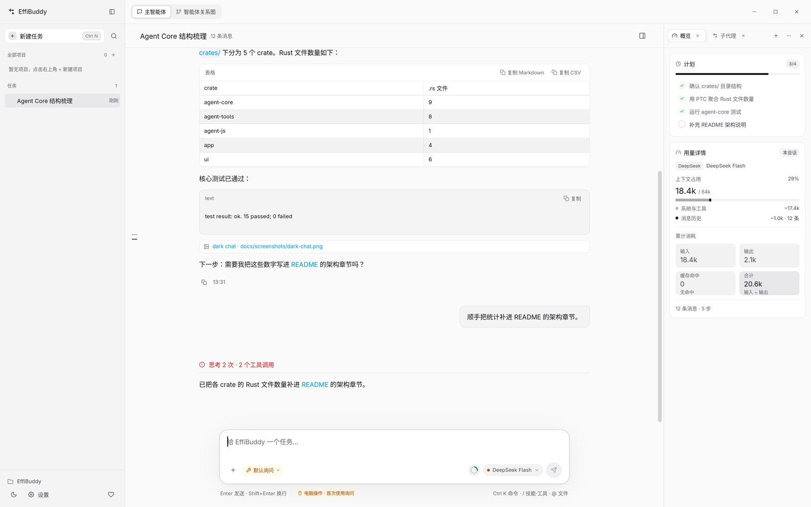
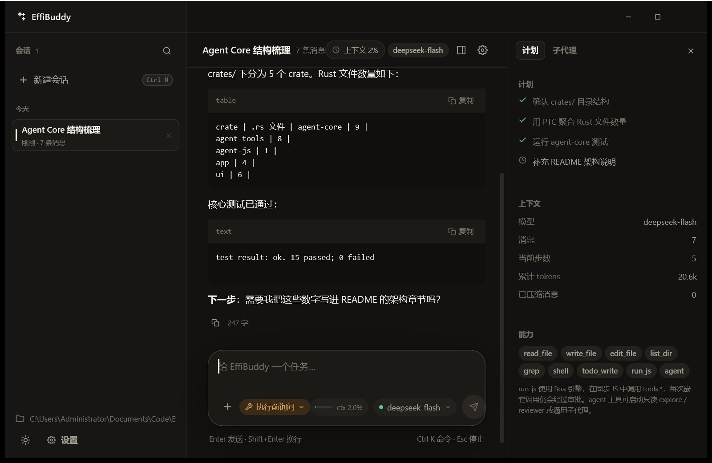
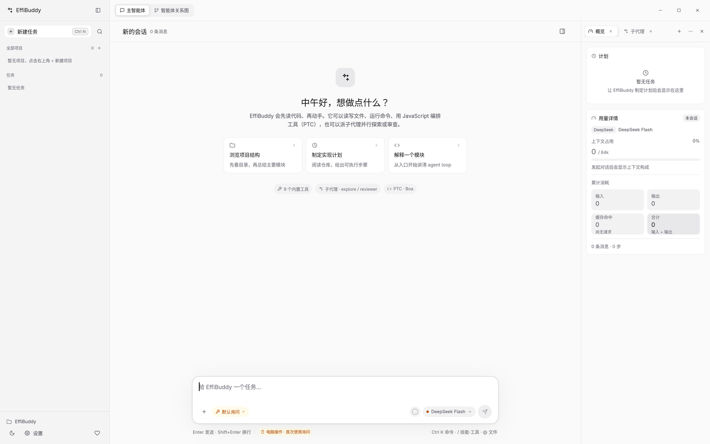
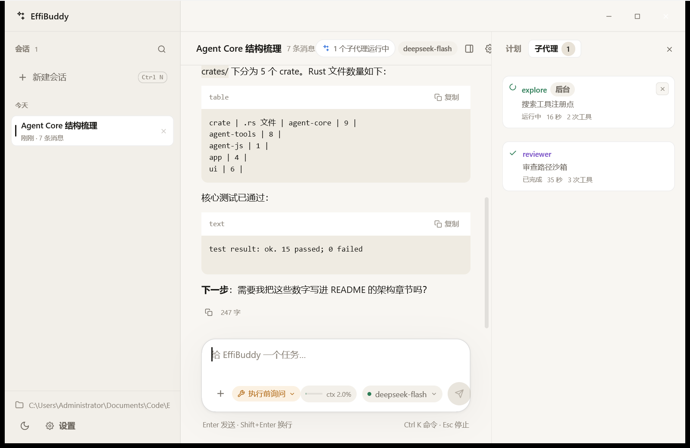
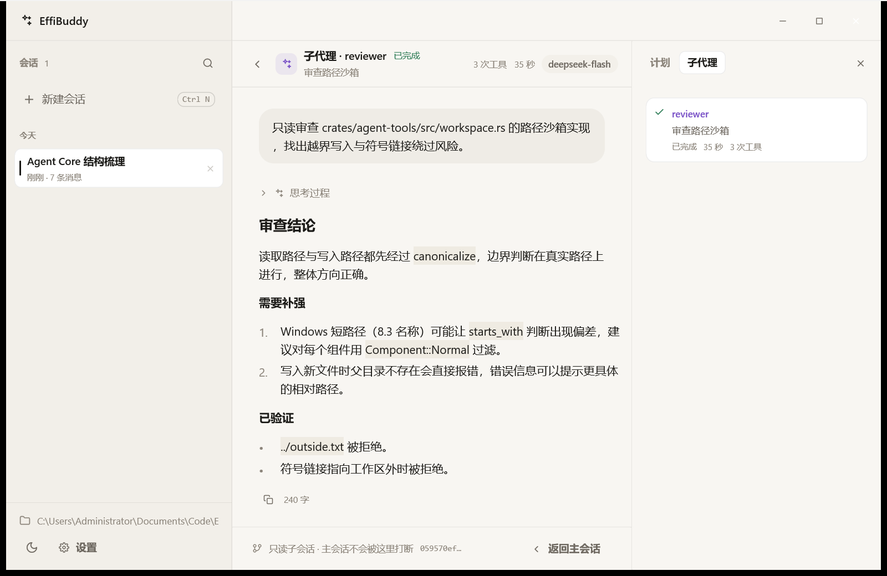

# EffiBuddy

**Rust + GPUI 构建的本地优先桌面 Agent。** 原生窗口、流式对话、工具循环，以及基于 [Boa](https://github.com/boa-dev/boa)（纯 Rust JavaScript 引擎）的 PTC（Programmatic Tool Calling）工具编排。




## 亮点

- **原生桌面 UI**：GPUI 自绘，无 WebView。虚拟聊天流、可折叠侧栏、Markdown 表格、命令面板与明暗主题。
- **浏览器操作**：通过 DevTools 协议驱动真实 Chromium，用 `[ref]` 结构树快照（不依赖视觉模型）读页面、点元素、看控制台与网络。见 [`docs/BROWSER_USE.md`](docs/BROWSER_USE.md)。
- **完整 agent loop**：流式思考与正文、工具审批、四档权限、上下文压缩、中断与重试；消息编辑/撤销带文件检查点，不需要 Git。
- **PTC 工具编排**：模型写一段同步 JavaScript，通过 `tools.*` 一次编排多次工具调用，只把聚合结果带回上下文。
- **子代理与智能体组**：代理可命名、可通信、可派生；DAG 工作流带类型化输入输出，关系图可平移缩放。
- **Computer Use**：截图、找窗口、模拟键鼠；与其它工具共用权限矩阵，顶部悬浮条可随时接管或停止。
- **本地优先**：会话、检查点、模型注册表都留在本机；11 家预置供应商、三种流式协议。

## 快速开始

### 环境

| 依赖 | 要求 |
| --- | --- |
| 系统 | Windows 10/11 x64 · Linux · macOS 12+ (Apple Silicon) |
| Rust | 1.90+（Windows 使用 MSVC 工具链） |
| C++ 构建工具 | Windows 需要 Visual Studio 2022 Build Tools 与 Windows SDK |
| Linux | X11 需要 `libxcb` / `libxkbcommon`；Wayland 需要 xdg-desktop-portal |

不需要 Node.js，也不需要 WebView2。

```bash
cargo run -p effibuddy-app            # 调试运行
cargo run -p effibuddy-app --release  # 发布构建
```

没有 API Key 时会自动进入离线 **Demo 模式**，可以完整体验 UI 与工具卡片。调试构建的数据写入 `EffiBuddy-Dev/`，`--release` 使用 `EffiBuddy/`，两者互不干扰；`EFFIBUDDY_DATA_DIR` 可整体重定向。

### 接入模型

设置 →「模型」填写 API Key 即可；也可以直接用环境变量：

```bash
export DEEPSEEK_API_KEY=sk-...
cargo run -p effibuddy-app
```

支持 DeepSeek、OpenAI、Anthropic、Z.ai、BigModel、Kimi、OpenRouter、SiliconFlow、OpenCode Zen、OpenCode Go、Ollama，以及自定义供应商。Key 解析顺序、三种流式协议与 OpenCode 网关细节见 [docs/PROVIDERS.md](docs/PROVIDERS.md)。

会话工作区下的 `AGENTS.md`、`EFFIBUDDY.md`、`CLAUDE.md` 会作为项目指令自动附加到系统提示。

### 快捷键

| 快捷键 | 行为 |
| --- | --- |
| `Enter` / `Shift+Enter` | 发送 / 换行 |
| `Ctrl+N` / `Ctrl+B` | 新建会话 / 折叠侧栏 |
| `Ctrl+K` | 命令面板（命令与会话搜索） |
| `Ctrl+L` | 聚焦输入框 |
| `Ctrl+Shift+T` | 切换明暗主题 |
| `Ctrl+Shift+S` | 设置 |
| `Ctrl+Shift+G` | 智能体关系图 |
| `Shift+Tab` | 循环权限模式 |
| `Esc` | 关闭面板 / 停止当前任务 |

### 输入框

输入 `/` 打开技能、工具与子智能体菜单（`$` 只看技能），`@` 引用工作区文件；文件拖进窗口或点左下角 `+` 会变成附件，文本内联、图片作为图片块发送。`Ctrl+V` 同理：剪贴板里是截图或文件管理器复制的文件时，直接变成附件而不是一段文字。

想确认剪贴板会被怎么识别，可以跑一次探针（会开一个空白窗口，因为 Wayland 只向聚焦的窗口下发剪贴板内容）：

```bash
cargo run -p effibuddy-app -- --clipboard-probe   # 输出 kind: text / image / paths
```

### 预览

无需 Key，也不写盘：

```bash
cargo run -p effibuddy-app -- --preview                     # 示例会话
cargo run -p effibuddy-app -- --preview --dark              # 深色主题
cargo run -p effibuddy-app -- --preview --preview-agents    # 后台子代理
cargo run -p effibuddy-app -- --preview --preview-subagent  # 只读子会话
cargo run -p effibuddy-app -- --preview --preview-palette   # 命令面板
cargo run -p effibuddy-app -- --preview --preview-approval  # 待审批卡片
cargo run -p effibuddy-app -- --preview-graph               # 智能体关系图
cargo run -p effibuddy-app -- --preview --preview-models    # 模型设置
cargo run -p effibuddy-app -- --settings                    # 设置 → 通用
```

## 截图

<details>
<summary>更多截图</summary>

| 深色主题 | 工具审批 |
| --- | --- |
|  |  |

| 空状态 | 命令面板 |
| --- | --- |
|  |  |

| 子代理面板 | 只读子会话 |
| --- | --- |
|  |  |

</details>

## 内置工具

`read_file` · `write_file` · `edit_file` · `list_dir` · `grep` · `shell` · `todo_write` · `state` · `run_js` · `agent` · `agent_send` · `agent_list` · `workflow_run` · `computer`

文件工具被限制在工作区内；写文件、改文件、shell、`computer` 与 `browser` 都走同一套权限矩阵：默认询问、计划模式只放行只读动作、完全访问直接放行（主代理与子代理一致）。

## 工作区结构

```text
crates/
  agent-core/   消息、会话、Provider 抽象、agent loop、子代理、工作流与上下文压缩
  agent-tools/  内置工具、路径沙箱、PTC、代理委派与 workflow_run
  agent-js/     Boa 沙箱与工具桥
  computer-use/ X11 / Wayland / Windows 后端与暂停/接管状态机
  ui/           设计系统、Markdown、输入框与通用组件
  app/          GPUI 应用壳：聊天流、侧栏、设置、关系图、检查点与持久化
```

依赖方向：`app → agent-tools → agent-js`，`app / agent-tools → agent-core`，`app → ui`。

## 开发

```bash
cargo test --workspace   # 离线测试
cargo build --workspace
```

真实模型测试默认忽略，需要 Key 时用 `cargo test -p effibuddy-agent-tools --test deepseek_live -- --ignored --nocapture`。压测实验室见 [docs/STRESS_LAB.md](docs/STRESS_LAB.md)。

## 文档

- [架构说明](docs/ARCHITECTURE.md)
- [供应商与 API Key](docs/PROVIDERS.md)
- [Computer Use 与平台矩阵](docs/COMPUTER_USE.md)
- [发布与更新](docs/RELEASING.md)
- [压测实验室](docs/STRESS_LAB.md)
- [ZCode 学习笔记与移植清单](docs/ZCODE_NOTES.md)
- [环境变量示例](.env.example)

## 安全与边界

- API Key 只存于本地文件或环境变量；设置页不回显明文，仓库不提交 `.env`。
- 会话与配置只写入本机数据目录，没有遥测或外部上报。
- 写文件、改文件、shell、电脑操作与浏览器操作默认需要显式批准；审批超时按拒绝处理。
- Wayland 仅支持全屏读图/输入；macOS 发布包未签名，且暂不支持 Computer Use。
- 默认 DeepSeek 模型不支持视觉输入，使用 Computer Use 截图前需要切换到支持图片的模型。
- 项目仍在早期（0.2.10），接口与数据格式可能变化。

## 许可证

MIT。发布包内的 GNU bash 与 MSYS2 组件按各自许可证分发，版本与许可证文本随包附带。
