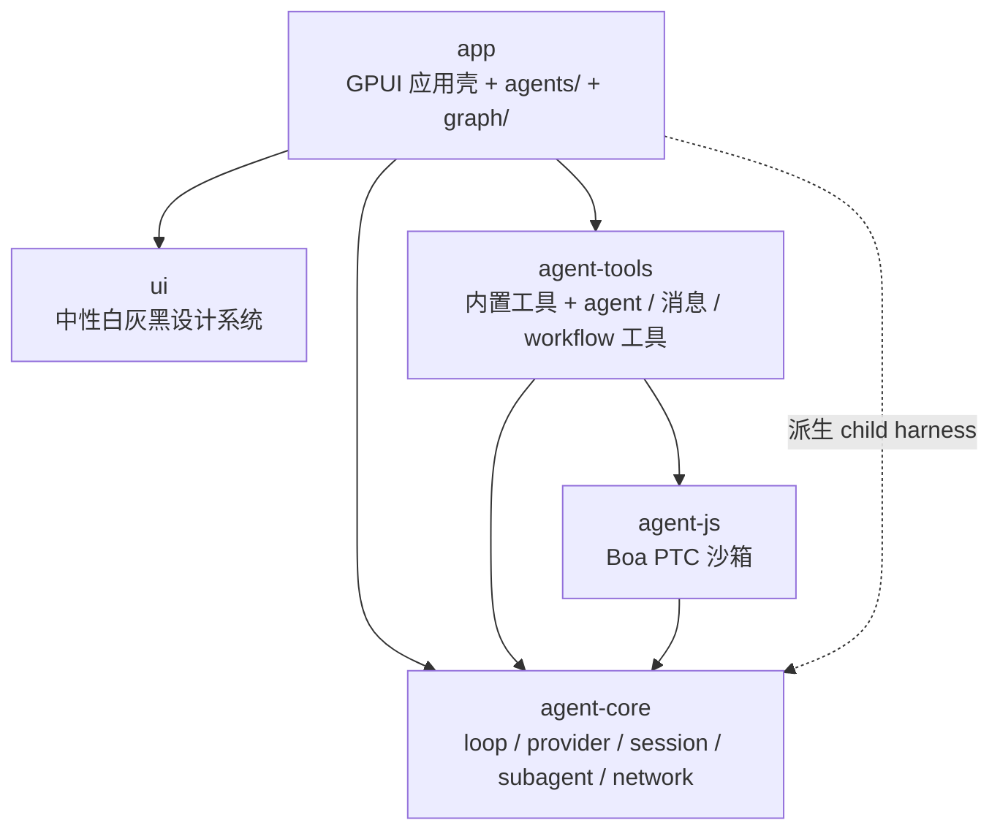
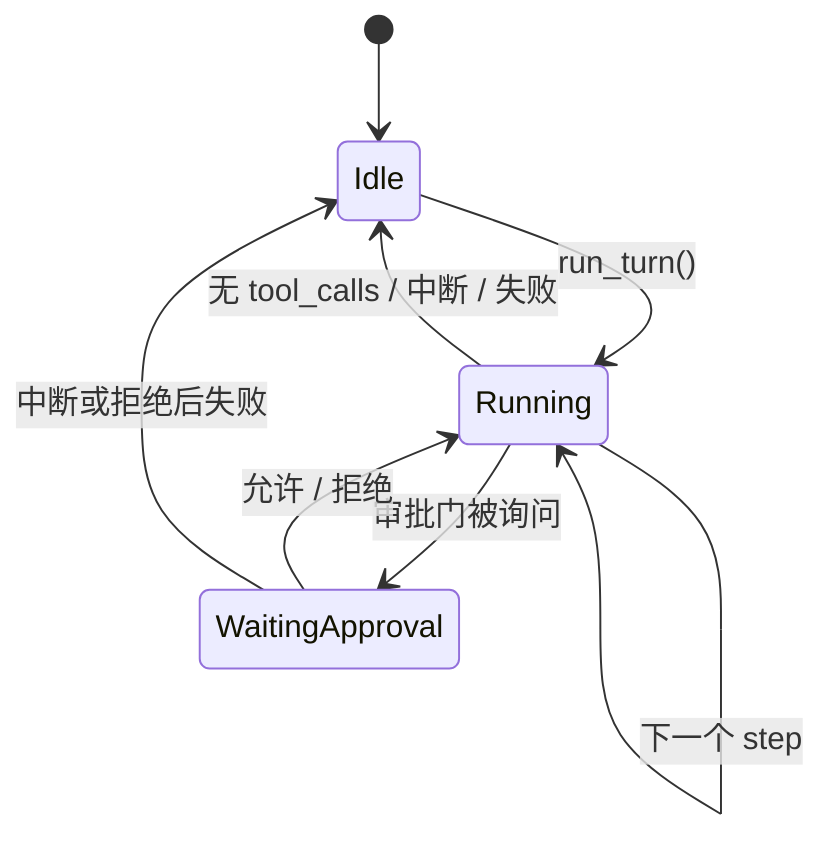
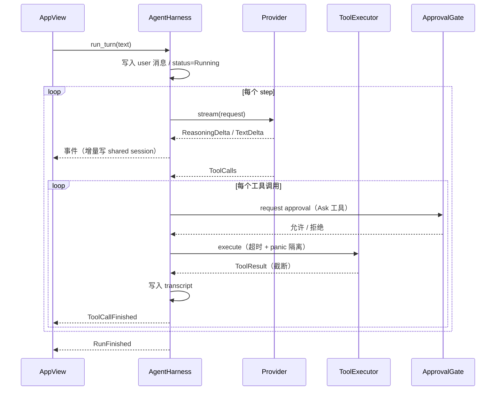
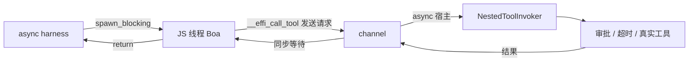

# EffiBuddy 架构说明

本文记录各层职责、数据流和关键取舍。代码量不大，读完后应能定位任何一处行为。

## 1. 目标与边界

EffiBuddy 是一个**单进程、可派生子代理**的桌面工具：

- 界面用 GPUI 原生绘制，不引入 WebView；
- 模型通过 OpenAI 兼容的流式接口接入（默认 DeepSeek `deepseek-flash`）；
- 工具调用支持普通 tool calling 与 PTC（脚本化编排）；
- 主代理可以通过 `agent` 工具派生命名子代理；**任何代理**都可以继续派生自己的子代理（深度上限 3 层），并用 `private` / `public` 控制谁能复用；
- `agent_send` / `agent_list` 提供代理间消息与地址簿；`workflow_run` 把带 JSON 契约的 DAG 作为「智能体组」执行；
- 「智能体关系图」以画布展示主代理、子代理、组框、委派/消息/数据连线，并允许检查每个节点的输入输出；
- 所有工具默认在工作区路径沙箱内运行，写操作经过审批门；
- 会话与配置本地持久化，不上报任何数据。

暂不包含：子代理的 fork/worktree 隔离、远程执行、插件系统；Windows 之外的完整平台实机验证（Linux X11/Wayland 已完成开发机验证，Windows 仍以 Windows 机器为准）。

## 2. 分层



依赖方向单向，`agent-core` 不知道 UI、不知道具体工具，只定义抽象：

- `ModelProvider`：流式补全；
- `Tool` / `ToolRegistry`：工具协议；
- `ApprovalGate`：审批门；
- `NestedToolInvoker`：PTC 回调宿主的唯一入口；
- `SubagentSpawner`：子代理的启动/停止/审批路由/寻址/消息投递边界；
- [`AgentDescriptor` / `AgentMessage` / `WorkflowSpec` / `AgentGraphRecord`]：代理网络、类型化契约与图持久化的共享数据模型。

## 3. 核心数据模型

`Message` 是持久 transcript 的单位，由 `Role` + 有序 `ContentBlock` 组成：

```rust
enum ContentBlock {
    Text { text },
    Reasoning { text },              // 模型思考，渲染为可折叠卡片
    ToolCall { call: ToolCall },     // id / name / arguments
    ToolResult { result: ToolResult } // 独立 role = tool 的消息
}
```

约定：

- `ToolCall.id` 与 `ToolResult.call_id` 严格配对，顺序与调用顺序一致；
- 工具结果单独成一条 `Role::Tool` 消息，符合 OpenAI 兼容接口的要求；
- 模型返回空 content 但带 tool_calls 时，assistant 的 `content` 序列化为 `null`，而不是空字符串；
- 加载历史时 `normalize_after_load` 会为悬空的 tool_call 补一条错误结果，避免下一次请求被 API 拒绝。

`SessionState` 是磁盘上的完整会话：

| 字段 | 作用 |
| --- | --- |
| `messages` | 完整 transcript |
| `todos` | `todo_write` 产生的计划 |
| `usage` | 累计 token（含缓存命中） |
| `compaction` / `compacted_upto` | 滚动摘要及其覆盖的消息前缀 |
| `cleared_tool_calls` | 仅对模型隐藏正文的旧工具结果（UI 仍显示原文） |
| `status` | Idle / Running / WaitingApproval |
| `steps` | 最近一次 turn 的模型调用数 |
| `last_error` | 最近一次失败原因 |
| `parent_id` | 子代理会话指向父会话；顶层会话为 `None` |
| `agent_name` / `agent_description` | 子代理档案名与任务描述 |
| `permission_mode` | 主会话权限模式（`default` / `accept_edits` / `plan` / `full_access`）；旧会话文件缺字段回落 `default` |

`Message` 额外有 `synthetic` 标记：后台任务通知以 user 角色发送给模型，但 UI 渲染为系统通知而不是用户气泡。`ToolResult.metadata` 保存只给 UI 用的结构化信息（如子代理 id），不会进入请求。

`SharedSession = Arc<Mutex<SessionState>>`，UI 与 harness 共享同一份内存状态；UI 每次渲染时短暂加锁读取。

## 4. Harness 状态机



`run_turn` 的入口检查：

1. 会话必须存在；
2. `status.is_busy()` 时直接返回 `Busy`（UI 不应提前把状态改成 Running）；
3. 写入用户消息，状态置为 Running，发出 `RunStarted`；
4. 进入 step 循环，持续模型调用直到模型不再请求工具（无步数上限）。

每个 step：

1. `build_chat_messages`：系统提示 + 压缩摘要 + 未压缩消息；
2. 流式调用 provider，delta 直接写入共享 transcript 并广播事件；
3. 完成后如果存在 tool_calls：逐个执行，结果写入 transcript，继续下一个 step；
4. 没有 tool_calls：turn 结束，`RunOutcome::Completed`。

任何路径退出都会把状态复位为 Idle，并发出唯一的 `RunFinished`。

### 事件

`AppEvent` 是 UI 的唯一输入源：主线是 `AppEvent::Main(HarnessEvent)`，子代理事件则包装为 `SubagentSpawned` / `SubagentHarness` / `SubagentFinished`。

| 事件（Main） | UI 行为 |
| --- | --- |
| `RunStarted` / `StepStarted` / `AssistantStarted` | 记录 run_id、标记聊天快照 dirty |
| `TextDelta` / `ReasoningDelta` | 只推进 reveal 缓冲，不重建列表 |
| `AssistantFinished` / `ToolCallFinished` | 持久化、刷新列表与活动行 |
| `ApprovalRequested` / `ApprovalResolved` | 入队/移除审批卡片、刷新状态行 |
| `TodosUpdated` | 刷新右侧概览 |
| `ContextCompacted` | 持久化压缩记录 |
| `UsageUpdated` | 刷新 token 统计 |
| `RunFinished` | 复位状态、持久化、错误/提示；成功结束后自动续跑（排队消息 → 后台通知） |
| `SteerDrained` | 一条「回合中插入」的用户消息在 step 边界进入 transcript；移除队列条目 |

| 事件（子代理） | UI 行为 |
| --- | --- |
| `SubagentSpawned` | 建立 `AgentTask`，代理卡片与面板出现 |
| `SubagentHarness` | 只更新该子代理的只读 `ChatList`、审批队列与计时；不进入父 transcript |
| `SubagentFinished` | 更新终态、报告、耗时；后台任务入队 `<task-notification>` |

事件通过 `tokio::sync::mpsc::UnboundedSender<AppEvent>` 汇总到一条前台泵，泵在 GPUI 的 `cx.spawn` 中 `await`，逐个调用 `handle_app_event` 并 `cx.notify()`。这样 UI 更新天然串行，不会在渲染线程里做阻塞 IO。

### 消息排队与回合中插入（steer）

任务运行中发送消息**不再被拒绝**，两条车道（参考 DeepSeek Harness 的 next-turn/next-step 双队列与 ZCode 的 guide/queue 投递语义）：

| 车道 | 按键 | 行为 |
| --- | --- | --- |
| 排队 | Enter | 进入 `AppView.pending_inputs`（可见、可删、可立即发送）；回合成功结束后 auto-drain 队首，开**新回合** |
| 插入 | Ctrl/Cmd+Enter | `AgentHandle::steer(text)` 交给 harness；在**下一个 step 边界**追加进当前 transcript，模型在下一请求中看到它，回合继续（turn 延长） |

关键语义：

- **注入点只在 step 边界**：`run_loop` 每次迭代顶部 `drain_steers()`——上一 step 的 tool result / assistant 全部落账之后、下一次请求构建之前。正在流式的响应和执行中的工具永远不会被插入打断。
- **回合延长**：模型产出纯文本本应结束回合时，若仍有未消费的 steer，循环继续而不是返回 `Completed`（ZCode 的 text-only 续跑边界）。steer 到达但回合已经结束 → 由宿主在 `RunFinished` 时通过 `take_pending_steers()` 收回，转为普通排队消息。
- **wire 模板**：steer 消息在 transcript 里保存原始文本（`Message.mid_turn = true`），`build_chat_messages` 构建请求时才包上 `<user-steer>` 框架（「这是运行中的真实用户输入，不是重启」），UI 渲染为带「运行中插入」chip 的普通用户气泡。checkpoint 的 turn 归属（`latest_user_turn_id`）跳过 steer 消息。
- **续跑优先级**：`resume_after_run` 在回合成功后先弹出队首排队消息；待投递的后台子代理通知与它合并进同一新回合（通知在前、用户消息在后）。队列空时才走纯通知路径。
- **held 队列**：回合 Interrupted/Failed 时队列挂起（`queue_held`），不会 auto-drain，也不会被无关的后台通知轮意外恢复；用户通过队列条的「发送」按钮处置。
- **队列不持久化**：与 ZCode 的裁决一致——进程死亡即丢，重启后由用户重发；已注入的 steer 消息是普通 transcript 消息，随会话落盘。

## 5. 一次 turn 的时序



### 重试规则

- 只有在**尚未产生任何可见输出**（没有 text delta、没有 tool call、没有 reasoning 提交）时，遇到可重试错误才重试；
- 指数退避：`retry_base_delay * 2^n`，默认最多 3 次；
- 一旦用户已经看到内容，失败就如实上报，避免重复生成造成 transcript 错乱。

### 中断

`AgentHandle::interrupt()` 取消 `CancellationToken`：

- 正在等待的流式响应立即结束；
- 正在执行的工具收到 `cancel`（shell 会 kill 子进程）；
- 当前 assistant 消息标记 `interrupted = true`，已产生的内容保留；
- 工具执行中途被中断时，会补一条错误结果保证 transcript 合法；
- 尚未到达 step 边界的 steer 消息由宿主收回转为排队消息，不会丢文本。

## 6. Provider 适配与模型注册表

`agent-core::model_config` 定义 `ProviderConfig` / `ModelConfig` / `ModelSelection` / `ModelConfigFile`：

- `ProviderConfig`：id、名称、是否内置、启用状态、`ApiFormat`、Base URL、API Key、额外 header、模型列表；
- `ModelConfig`：模型 id、显示名、启用状态、上下文窗口、最大输出、能力（工具/视觉/推理/JSON Schema/联网）、推理档位；
- `ModelConfigFile`：带 `schema_version` 的注册表、供应商顺序与默认选择；`normalize()` 补齐内置供应商并修正悬空默认值；`resolve()` 对旧会话里已删除的模型生成保守的临时元数据；
- `ResolvedModel::build_provider()` 按 `ApiFormat` 构造适配器，并把模型上下文窗口注入 `ModelProvider::context_window()`。

三种适配器都实现 `ModelProvider::stream`：

| 适配器 | 请求 | 流式协议 |
| --- | --- | --- |
| `OpenAiCompatProvider` | POST `/chat/completions`，`stream_options.include_usage` | `choices[].delta`、`reasoning_content`、`tool_calls` 片段 |
| `AnthropicMessagesProvider` | POST `/v1/messages` | `content_block_delta`（text/thinking/input_json）、`message_delta.usage` |
| `OpenAiResponsesProvider` | POST `/responses` | `response.output_text.delta`、`function_call_arguments.delta`、`response.completed.usage` |

共同约定：

- 逐块解析 SSE，支持 CRLF、跨块行边界与 `[DONE]`；
- 累加 tool-call 参数片段，按 index/item 重组，参数非法时保留 `argument_parse_error`；
- 解析 usage 与 prompt cache 命中；区分可重试错误（超时、连接失败、408/409/425/429/5xx）与永久错误（4xx 其他）；
- `ChatRequest.reasoning_effort` 只在模型显式配置推理档位时写入。

`DemoProvider` 用同一接口模拟一段带 reasoning、工具调用与结果的对话，保证无 Key 时 UI 可完整演示。`ModelConfigStore`（`app/model_config.rs`）负责把注册表持久化到 `providers.json`，首次启动时从旧 `config.json` 的 Base URL / Key / Model 迁移。

## 7. 上下文压缩

`context.rs` + `harness.rs`，按 ZCode 的链路实现：

- **百分比策略**：触发阈值、保留原文比例、摘要上限都是上下文窗口的百分比（默认 80% / 20% / 10%），在设置 → 上下文中可改；模型窗口换算为 token 预算时还会扣掉输出预留。
- **每个模型步都检查**：按 user/assistant 消息切分 round，长工具回合（只有 1 条用户消息、几十轮工具调用）也能压缩；边界永不落在孤立的 tool result 上。
- **先微压缩**：达到阈值的 90% 时，把较早的读取/搜索/命令输出替换为占位符（transcript 与 UI 保留原文），避免为噪声付摘要成本。
- **模型摘要**：让当前会话模型生成结构化摘要（`<analysis>` + `<summary>`），请求只带文本、不带工具；失败时回退到本地摘录取并标记 `SummarySource::Heuristic`。
- **用量校准**：决策取“本地估算（含工具 schema）”与 provider 上报的 `last_prompt_tokens` 的较大值；压缩后把当前足迹改写成压缩后的估算值。
- **反应式兜底**：provider 报 context overflow 时强制压缩并重试一次；连续摘要失败达到上限后只走本地摘录。
- **后台预压缩（试验，默认关）**：达到“预压缩起点”百分比时，用当前历史快照在后台写摘要，主会话的模型请求/工具调用继续跑；到达触发阈值时校验模型、`compacted_upto`、边界消息和快照后增长量（不超过阈值 40%），通过就直接换入，否则丢弃并正常重压。摘要未写完时最多等 15 秒；`HeldCompaction` 只在内存里，重启即丢。
- 摘要以 system message 附加，`compacted_upto` 只移动模型可见窗口，transcript 始终完整可追溯。

`CompactionRecord` 额外记录触发器（auto/reactive）、摘要来源、压缩前后 token 与消息数，概览页和诊断可以直接读取。

## 8. 工具执行管线

`ToolExecutor`（harness 内部）对每次调用执行固定顺序：

1. **查找工具**：未知工具直接生成错误 observation，不中断 turn；
2. **参数解析**：JSON 解析失败同样变成错误 observation；
3. **审批**：`Ask` 策略通过 `ApprovalGate` 请求 UI；超时（默认拒绝）、拒绝、允许本次、本会话允许；主会话的审批门是 `ModeApprovalGate`（见下），Plan 模式下所有工具都过门；
4. **执行**：`tokio::time::timeout` 包裹；`panic` 被捕获并转为错误结果；
5. **截断**：结果超过 `max_tool_output_chars`（24k）时截断并标注；
6. **副作用**：`ToolEffect::SetTodos` 更新会话计划并广播 `TodosUpdated`。

### 权限模式门

主会话的审批门是 `ModeApprovalGate`（`agent-core/src/tool.rs`）包装 `BrokerApprovalGate`，`ApprovalGate` trait 与子代理的门不变：

- `ToolClass` 按工具名分类：`read_file` / `list_dir` / `grep` / `todo_write` 只读，`write_file` / `edit_file` 编辑，`shell` / `run_js` / `workflow_run` 命令，其余（`agent`、消息类）归 Other；
- 四档 `PermissionMode`（`default` / `accept_edits` / `plan` / `full_access`，Shift+Tab 循环）的本地决策：Default 全转发、AcceptEdits 编辑类本地批准、Plan 编辑与命令类本地拒绝且只读类本地放行、FullAccess 全放行；本地决策不触达内层门，也不产生审批卡；
- 模式闭包每次审批请求实时读 `SessionState.permission_mode`，运行中 Shift+Tab 对下一次工具调用即生效；
- Plan 模式下 harness 对**所有**工具询问审批门，不受 `Auto` 策略与「本会话允许」缓存影响：只读工具零打断，编辑与命令被直接拒绝并附「先出计划」文案，`agent` 等其他类仍弹卡由用户决定；
- 权限模式只装配在主会话上；子代理 harness 用裸 `BrokerApprovalGate`（见 §10），审批卡对子代理请求单独注明「不受主会话权限模式影响」。

工具拿到的 `ToolContext` 包含：工作区 `cwd`、会话 id、调用 id、取消令牌，以及可选的 `NestedToolInvoker`（仅 PTC 使用）与 `FileCheckpointSink`（消息编辑/撤销的文件快照）。

### 文件检查点（消息编辑/撤销）

`agent-core/src/checkpoint.rs` 定义 `FileCheckpointSink`；宿主把实现放进 `HarnessConfig.checkpoint_sink`，`ToolExecutor` 再复制到每次 `ToolContext`：

- `write_file` / `edit_file` 在真正写盘前调用 `before_write`（首次接触该文件时保存原字节），成功后调用 `after_write`（记录写入内容的 FNV-1a 摘要、操作次数、工具名），失败调用 `write_failed`（标记为不可安全还原）；
- `shell` 只调用 `note_shell`，因为任意命令的文件副作用无法追踪；UI 会把它们列在「无法追踪的改动」里；
- 子代理 harness 克隆同一份 `HarnessConfig`，因此子代理与后台任务的文件改动都落到父用户消息的 `TurnCheckpoint`；
- `RunStarted` 时宿主把 recorder 绑定到该 turn 的用户消息 id，避免运行结束后才写盘的后台子代理串到下一轮。

快照存放在 `<数据目录>/checkpoints/<session>/<message>/NNNN.bin`，元数据随 `SessionState.checkpoints` 持久化。回退计划（`app/checkpoint.rs`）按路径合并：取**最早**的 before 快照与**最晚**的 after 摘要；当前内容与 after 不一致即 `ExternalModified`，快照缺失/不可读/路径类型变化/写入未完成各自成为冲突项。存在任一冲突时一个文件都不写，只允许「仅撤销对话」；全部安全时先重新校验当前内容，再逐个原子写入并保留权限。整个过程不调用 Git。

**性能模型**（`checkpoint_perf_lab`，release 下 `cargo test --release -p effibuddy-app --bin effibuddy checkpoint_perf_lab -- --ignored --nocapture`，可用 `EFFI_PERF_FILES/BYTES/TURNS/ROOT` 调参）：

- 常规文件（64KiB）首次写入带快照约 +0.14ms/文件（tmpfs）、+1.6ms/文件（外置挂载盘），重复写入走摘要更新快速路径约 3 倍 baseline；瓶颈是磁盘本身，检查点逻辑只多两次 `fs::write`/`fs::read`。
- 预检与还原是同步 UI 线程操作，成本 ≈「读快照 + 读当前 + 各哈希一次」：25MiB 轮约 37ms，80MiB 轮约 120ms。超大轮（接近单文件 16MiB 上限 × 120 文件）会卡 UI 一秒级——如果实际使用中出现，考虑给 plan 加总字节预算或把预检/还原挪到后台线程再弹确认。
- 快照 blob 在会话锁外写入（锁内只登记元数据），64 turn 上限使元数据 JSON 稳定在 ~0.5–2.5MiB；编辑/撤销的持久化走单次序列化（stage → write → 入队同一份 payload），比旧的「save + stage 双序列化」省约 45%（1.27ms → 0.71ms tmpfs，4.71ms → 3.94ms 挂载盘）。
- 用户消息文本在 `ChatItemKind::User` 里是 `SharedString`，hover 动作条不再每帧克隆全文。

### 随包 shell 运行时（bash）

`agent-tools/shell.rs` 的 `ShellSpec` 在构造 `ShellTool` 时解析一次，顺序为：

1. `EFFIBUDDY_SHELL`（必须是存在的文件；开发/预览时覆盖用）；
2. 可执行文件旁边的随包运行时：
   - Linux/macOS：`<exe>/runtime/bash`、`<exe>/runtime/bin/bash`、`<exe>/../lib/effibuddy/runtime/bash`（deb/rpm）、`<exe>/../Resources/runtime/bash`（macOS .app）；
   - Windows：`<exe>\runtime\msys\usr\bin\bash.exe`、`<exe>\runtime\bash.exe`；
3. 平台默认：Unix `sh -lc`，Windows `cmd /C`。

Unix 上沿用登录 shell（`-lc`），保留 `/etc/profile` 与 `~/.bash_profile` 的 PATH 约定；Windows 的 MSYS2 运行时改用 `--noprofile --norc -c`，避免 profile `cd` 到 HOME 破坏工作区 cwd，并由宿主把 `runtime\msys\usr\bin` 前置到 PATH（Cygwin 在启动时把 Windows 路径列表转成 POSIX 形式）。命令仍在 workspace 主根下执行，stdin 为空、stdout/stderr 捕获后按 24k 截断。

发布侧：`scripts/fetch-bash.sh` 在 Linux 用 musl-gcc 构建最新 GNU bash 静态二进制，在 macOS 按系统库构建；`scripts/bundle-msys-shell.py` 从 MSYS2 实时仓库数据库解析 bash + coreutils/findutils/grep/sed/gawk/diffutils/tar/gzip/which 的依赖闭包，校验 sha256 后裁剪文档/翻译解出 `runtime/msys`。构建脚本只在 release 流水线运行，仓库不保存二进制。

### 路径沙箱

`agent-tools/workspace.rs`：

- 项目可含多个文件夹：主文件夹锚定相对路径、shell cwd 与文件树，其余文件夹作为附加工作目录；
- 读取时 `canonicalize` 后必须位于任一已授权根之内；
- 写入时先规范化父目录，拒绝 `..` 越界与任何根之外的绝对路径；
- 符号链接按规范化后的真实路径判断；不可访问的附加根会被跳过（主根缺失则启动失败）；
- 展示路径：主根内为相对路径（形状不变），附加根内为绝对路径；checkpoint 恢复按同一根集合校验，绝不会写到项目之外。

## 9. PTC 沙箱

### 线程模型



- JS 是同步执行模型，工具是异步的；桥接方式是「JS 线程阻塞等待 + 宿主异步执行」。
- `agent-js` 通过线程本地 `BRIDGE` 把调用转发出去，宿主在 `run_js` 工具里用 `tokio::runtime::Handle` 驱动异步工具。
- 每个工具等待都有独立超时（120s），整个脚本有总超时（30s），取消令牌会同时打断两侧。
- 嵌套调用仍然走完整的 `ToolExecutionContext`，因此 `write_file` 在 PTC 里也会弹审批，而不是绕过审批。

### 限额

| 项 | 默认值 |
| --- | --- |
| 脚本长度 | 24,000 字符 |
| 脚本总时长 | 30s |
| 单次工具等待 | 120s |
| 工具调用次数 | 32 |
| console 日志 | 100 条 / 每条 2,000 字符 |
| 返回值 | 24,000 字符 |
| 循环迭代 | 2,000,000 |
| 栈大小 | 10 KB |
| 递归深度 | 有上限 |

`run_js` 的描述里明确要求：同步 JS、只用 `tools.*`、用 `return` 返回结果、用 `try/catch` 处理工具错误、不要调用 `run_js`。

## 10. 子代理、代理网络与智能体组

子代理不是第二个进程，而是**第二个 `AgentHarness`**：独立 `SessionState`、独立工具注册表、独立取消令牌和审批门。父模型只看到一份压缩后的报告，完整子对话留给 UI。

### 分层

```
agent / agent_send / agent_list / workflow_run (agent-tools)
    │  校验参数、组织 prompt、格式化 hand-back / 解析工作流 spec
    ▼
SubagentSpawner (agent-core trait)
    │  run / launch / stop / respond_approval / agents / visible_agents / send_agent_message
    ▼
app/agents/
    registry.rs  命名、记录、可见性、组聚合
    prompt.rs    子代理系统提示词
    runtime.rs   SubagentService：创建子 SessionState + 过滤工具 + 子 Harness + 审批路由 + 唤醒
    ▼
AgentHarness (child) ── HarnessEvent ──▶ AppEvent::SubagentHarness
```

`agent-core` 不依赖 app；`agent-tools` 只依赖 trait；只有 app 知道如何创建子会话、寻址和发 UI 事件。`app/graph/` 不执行任何代理，只消费事件和 `SessionState.graph`。

### 档案、命名与可见性

| 名称 | 权限 | 工具 |
| --- | --- | --- |
| `general-purpose` | 读写 | 全部 + `agent` / `agent_send` / `agent_list` / `workflow_run` |
| `explore` | 只读 | `read_file` / `list_dir` / `grep` + `agent` / `agent_send` / `agent_list` |
| `reviewer` | 只读 | 同上 |

档案由 `builtin_subagent_profiles()` 提供，三者都 `allow_spawn: true`：**任何代理都可以创建属于自己的子代理**。是否存在递归只由绝对深度上限（`MAX_AGENT_DEPTH = 3`）决定，提示词无法绕过。

每个实例由 `SubagentService::assign_name` 分配唯一 `name`（重复时加 `-2` / `-3`）。`AgentVisibility` 决定寻址范围：

- `private`（默认）：只有创建者（`owner_id`）可以 `agent_list` / `agent_send`；
- `public`：同一会话内所有代理都可以发现并复用。

只读父代理的子代理强制只读（`parent_read_only || profile.read_only || request.read_only`），显式 `read_only: false` 不能提权。自定义档案不需要内置 profile：`system_prompt` 或 `tools` 任一存在即可创建临时档案。

### 代理间消息

`agent_send` 通过 `SubagentSpawner::send_agent_message` 投递 `AgentMessage`（id/from/to/kind/text/data）。`SubagentService`：

1. 用调用者的 `session_id` 反查发送者描述符，并执行 `can_address` 可见性检查；
2. 发给 `main` 时只发 `AppEvent::AgentMessageToMain`，由 AppView 追加 transcript 并决定是否唤醒；
3. 发给子代理时直接追加 `Message::from_agent_message`（模型看到 `[agent-message]` 框架文本），并持久化；
4. 目标运行中 → `pending_wake = true`，消息在下一个模型 step 被读到；目标空闲 → 立即 `spawn_wake` 开启 `run_pending`。

消息在 UI 中由 `app/chat_agent.rs` 渲染为独立卡片，与用户气泡、后台任务通知区分；主会话和子会话复用同一个 `ChatList`。

### 前台与后台

- **前台**：`AgentTool` 等待 `SubagentSpawner::run`。子 harness 完成（或失败/被停止）后，只把最后一条非空 assistant 文本作为报告返回，并包裹 `[Subagent hand-back]` 提示注入防护。工具结果通过 `ToolOutput.metadata` 携带 `agent_id` / `agent_name` / `child_session_id` / `data` 给 UI。
- **后台**：`launch` 同步创建子会话、注册取消令牌、发送 `SubagentSpawned`，然后 `runtime.spawn` 执行并立即返回。完成时发送 `SubagentFinished`。

父代理取消时，`ToolExecutor` 会 drop 工具 future；`SubagentService::run` 仍然把子任务 spawn 在 runtime 上，并通过 watcher 把父取消令牌转发给子令牌，所以子代理会走完清理路径并发出终态事件，而不是留下一个永远 Running 的会话。

### 完成通知与唤醒

后台子代理完成（`completed` / `failed`）时：

1. `SubagentService` 持久化子会话并发送 `SubagentFinished`；
2. `AppView` 更新任务卡片，并把 `<task-notification>` 文本放入待注入队列；
3. 若父 turn 空闲，立即把通知作为 `Message::synthetic_user` 追加到父 transcript 并唤醒（`resume_after_run`：若用户有排队消息，队首消息与本批通知合并进同一新回合，通知在前、用户消息在后）；
4. 若父 turn 正在运行，通知留在队列，等父 turn 成功结束后再注入，避免插在 tool_call 与 tool_result 之间。

`synthetic` 消息对模型是普通 user 消息，对 UI 是系统通知卡片。由 `agent_send` 触发的唤醒标记 `report.wake = true`，不会再生成第二条父通知。

### 类型化契约与智能体组

`SubagentRequest.output_schema` 存在时，子代理提示词要求只返回 JSON；`SubagentService::execute_run` 用 `extract_json_value` + `validate_json` 校验，失败则把状态降为 `Failed`，下游永远拿不到未校验的数据。

`workflow_run` 把 `WorkflowSpec`（节点、边、输入/输出 schema、`max_parallel`）当作 DAG 执行：

- `spec` 直接给 JSON；`code` 在 Boa 里运行一个**只构造数据**的 `workflow` builder，返回 spec，不暴露工具/模型能力；
- `WorkflowSpec::topological_layers()` 做 Kahn 分层，层内按 `max_parallel` 并发调用 `SubagentSpawner::run`；
- 边是数据依赖，`render_node_prompt` 替换 `{{input.*}}` / `{{node.*}}`，没有占位符时自动附加 Input/Upstream 段；
- 每个节点是带 `group_id` / `group_name` 的普通子代理，因此图上会自动形成组框；
- 组输出取单一 sink、`output` 节点、显式 `@output` 边，或多 sink 的 `{node_id: value}`；组级 schema 在返回前校验；
- `inputs` 数组用于批量运行，上限 8 组 / 64 个节点。

### 审批

子 harness 使用自己的裸 `BrokerApprovalGate`（不包模式门：权限模式只对主会话生效，见 §8），事件被转发到同一条 UI 泵：

- `AppEvent::SubagentHarness { agent_id, event }` 把 `ApprovalRequested` 标上来源；
- `AppView.pending_approvals` 是队列，第一项渲染在主输入区；查看子会话时也会在底部渲染同一张卡片；
- 响应按 `agent_id` 路由回 `SubagentService::respond_approval`。

只读档案的工具全部是 `ApprovalPolicy::Auto`；可写子代理的写操作仍然逐次询问，不会因为“子代理”而绕过审批。`workflow_run` 本身是 `Ask`。

### 取消与停止

- 前台子代理：父取消令牌 → watcher → 子令牌；UI 停止按钮也可直接取消子令牌。
- 后台子代理：`tokens: Mutex<HashMap<agent_id, CancellationToken>>`；`stop(agent_id)` 取消并清除 `pending_wake`，子 harness 在下一个 await 点退出并回报 `Cancelled`。
- 切换会话或删除当前会话时，`reset_subagents()` 会 `stop_all()` 并清空 UI 任务，避免旧会话的后台任务影响新会话。

### 关系图

会话新增 `graph: AgentGraphRecord`（`agent-core/src/network.rs`），包含节点记录、边、最近 200 条代理消息和平移/缩放。事件写入路径：

```
SubagentSpawned ──▶ graph/persist.rs::record_spawn   （节点 + 委派边 + 组框）
SubagentFinished ─▶ record_finish                    （状态/输出/token）
AgentMessage* ────▶ record_message                   （消息 + message 边）
workflow metadata ▶ record_workflow_metadata         （组输入/输出/schema/数据边）
```

`graph/model.rs` 把持久记录与实时 `AgentTask` 合并成 `GraphProjection`：按深度分列布局，组框内按网格排成员，边端点取节点/组框左右中心。`graph/canvas.rs` 用 GPUI `PathBuilder::stroke` 画贝塞尔曲线和箭头，`graph/render.rs` 渲染节点/组框/工具栏，`graph/inspector.rs` 渲染输入、输出、契约、成员和“打开完整会话”。

### 持久化

子会话写入同一个 sessions 目录，但带 `parent_id`；`SessionStore::summaries()` 会过滤这些文件，所以它们不会出现在顶层会话列表。UI 运行中通过 `SharedSession` 直接渲染子会话；应用重启后任务面板不恢复运行状态，但子会话文件和关系图记录仍可读取。

## 11. UI 架构

### AppView

单一根实体 `AppView` 持有：

- 配置与会话存储；
- tokio runtime 与 `AppEvent` 发送端（主线事件 + 子代理事件共用一条 UI 泵）；
- `active: Option<ActiveSession>` 与 `active_run`；
- 子代理投影：`subagent_tasks`、`subagent_services`、`side.agent_views`（每个子会话一个独立 `ChatList`）；
- `models: ModelConfigStore`、`settings: SettingsState`、`model_menu: ModelMenuState`；
- 输入框实体、设置页输入实体、命令面板输入实体与选中索引；
- 命令面板：条目按 `palette_score` 评分排序（标题 / keywords 的前缀、子串、子序列分级，含中英 keywords，汉字 query 跳过子序列级），`palette_recent` 命中项按最近使用置顶并随执行写入 `config.json`；面板开启时用 `App::intercept_keystrokes` 捕获 ↑/↓ 环绕移动选中并阻断输入框光标移动，`ScrollHandle::scroll_to_item` 保持选中可见，Enter 执行当前选中项；
- `chat: ChatList`（虚拟列表状态、流式 reveal、吸底与滚动条状态）；
- 展开状态集合（reasoning / tool 卡片 / 工具分组）；
- 主题、`side: SidePaneState`（页签、宽度、文件树、git 变更）、审批队列与提示状态。

只有结构性事件（消息增删、工具边界、run 状态变化）才从会话重建聊天快照；token delta 只更新 reveal 缓冲，不复制 transcript。`lock_session` 也只在重建或读取标题等短操作中持有。

### 虚拟聊天流（`app/chat.rs`）

聊天流使用 GPUI 的变高 `list` / `ListState`，只布局可视区域与 overdraw 区：

- 每个消息项是 `ChatItem`（user / assistant / system / task-notification / run-status / error / notice），`assistant` 持有消息快照与思考耗时；`Role::Tool` 不单独成项，结果按 `call_id` 进入共享表。synthetic user 消息渲染为后台任务通知卡片，不显示原始 XML。
- 连续 3 个以上的工具调用折叠成一行「N 个工具调用」摘要，展开后按垂直导轨显示单项；`agent` 调用永远单独渲染为代理卡片，通过 `parent_call_id` 关联 `AgentTask`。
- 结构变化时按 item 指纹找公共前缀，`ListState::splice(prefix..old_len, new_len-prefix)` 只让变化项重新测量；切换会话才 `reset`。未变化的 `ChatItem` 直接复用 `Rc`，工具结果 payload 也按内容复用。
- 流式文本增长不 splice：最后一项只要在可视区，`list` 每帧都会重新测量；离开可视区后无需更新，滚回来时再测量。
- `ListAlignment::Top` + 手动吸底：`pinned` 时每次渲染在**布局之前** `scroll_to(item_count)`，短内容会被钳到顶部，长内容贴底；上滚后由 `set_scroll_handler` 标记，下一帧用 `max_offset_for_scrollbar` / `scroll_px_offset_for_scrollbar` 精确判断是否回到底部。
- 未吸底时渲染右下角「回到底部」按钮；未吸底期间有新内容会显示强调色小圆点。右侧另有一条 6px overlay 滚动条，点击轨道可跳转。

### 流式 reveal

`StreamReveal` 保存当前消息的完整目标文本、已显示字节数与思考计时：

- `TextDelta` / `ReasoningDelta` 只追加到缓冲；渲染时使用 UTF-8 字符边界上的前缀。
- 每帧推进 `4 + backlog/10` 个字符（上限 160），大 burst 自动加速追平；用 `cx.on_next_frame` 自调度，backlog 清空即停。
- `AssistantFinished` / 中断时以会话中的权威文本 flush 到完整长度，避免 provider 最终文本与流式片段不一致。
- 流式 Markdown 在源文本末尾附加 `▍` 光标，因此光标始终跟随最后一段（段落、列表项或代码块）内联显示；复制按钮仍使用完整文本。
- 思考块默认折叠（参考 ZCode）：流式时显示「正在思考 · N 秒」+ 最新一行预览，结束后显示「思考了 N 秒」；用户手动展开后保持展开。

### 渲染性能模型

GPUI 没有跨帧元素复用：每帧都要重建可视区所有元素的树。因此性能工作集中在两件事——**减少每帧无谓的计算**（GPUI 反正要重建元素，重复解析/克隆/序列化是纯浪费）与**减少无谓的整窗重绘**：

- **事件合帧**：前台泵每被唤醒一次就排空整个事件通道（`try_recv` 循环），一次 entity update 处理全部积压 → 每 token burst 至多一次整窗 notify；打字机 reveal 循环已排帧时 delta 不再额外 notify。面板关闭的子代理 delta 完全静默（transcript 在会话里，打开面板时重建）。
- **Markdown 两段式渲染**（`ui/markdown.rs`）：pulldown 事件先归约为主题无关的 IR（`BlockIr`），再从 IR 逐帧构建元素。IR 是缓存的载体——完整文档按 (内容哈希, 长度, 主题高亮键) 整篇缓存（历史消息每帧零解析、零哈希，`chat.rs` 在 rebuild 时就算好 `text_key`）；流式文档切成 fence 安全的分块（空白行切分 + 列表/缩进续行回并，分块解析与整篇解析等价，有等价性测试兜底），每帧只重解析正在输入的那一块。
- **每帧分配削减**：助手项在 rebuild 时预计算 `text`/`reasoning`/`char_count`/`text_key`；思考正文只在展开时构建；工具行折叠时不再 `serde_json` 美化参数、不再整段克隆工具输出（MB 级）；工具组折叠时不构建内部行。
- **侧板**：文件预览与文件树改用 `uniform_list` 虚拟化（预览行在 `open_file` 时一次性切好，树行按需缓存展开态快照）；diff 的解析 + 词级 diff + 折叠按内容哈希缓存，展开 hunk 状态在渲染期应用。
- **UI 线程无阻塞 I/O**：会话持久化只在前台克隆 + 序列化快照，写盘走串行后台队列（`SessionStore::stage` → `PendingSave`，按发送顺序写保证最后赢）；会话列表扫描在后台线程执行，代际计数防止旧结果覆盖新结果；设置「智能体」页的档案目录扫描在打开期间缓存。
- **并发压测**：1000 路会话/子代理、虚拟模型与内存工作区见 [STRESS_LAB.md](STRESS_LAB.md)。
- **度量**：`EFFIBUDDY_PERF=1 cargo run -p effibuddy-app` 每 2 秒向 stderr 输出一次 render 耗时 p50/p95 与 markdown 缓存命中数（`ui::markdown_cache_hits`）。测量表明元素构建是每帧成本的大头（约 0.5ms/7KB 消息，release），markdown 缓存削减的是其上的解析部分，收益随消息变长而增大。

### 活动行

- 思考行：sparkles + 「正在思考 · 0:03」/「思考了 7 秒」；实时 spinner，结束后 chevron；展开后是带左导轨的正文（最大 280px 内部滚动）。
- 工具行：紧凑一行，状态图标 + 工具类别（读取 / 写入 / 搜索 / 命令 / JS…）+ 主要参数摘要 + 耗时 + 状态词 + chevron；展开后是参数/输出代码面板。连续调用分组后，摘要行显示去重后的类别与总耗时。
- 代理行：彩色头像 + 档案名 + 「子代理」/「后台」chip + 任务描述 + 工具次数 + 耗时 + 状态；点击打开只读子会话，而不是塞进父 transcript。
- 运行状态行：脉冲点 + 「工作中 · 1分16秒」+ 当前活动（等待批准 / 正在执行 shell / 正在思考）+ 停止按钮；500ms ticker 让计时在工具阻塞时也继续走，但只在展示的秒数跳变时 notify（计时文本是秒粒度）。父代理空闲时，子代理 ticker 单独驱动任务面板计时，同样按秒跳变 notify。
- 新消息 260ms 淡入；历史消息在首次加载时不重放动画。

### 左侧会话栏

- 展开态 272px，按「置顶 → 全部项目 → 任务」分组；项目是具名容器（`projects.json`），行内 `+N` 徽标表示附加文件夹数量，悬停显示全部路径，菜单可管理文件夹、按根打开、折叠与移除；
- 会话按项目 id 归属（旧会话按路径解析到项目根），折叠键为 `project:<id>`；「+」支持一次多选文件夹新建项目，第一个为主动文件夹；
- `Ctrl+B`（标题栏按钮或命令面板）折叠为 52px 图标栏：保留新建会话、搜索、工作区提示、主题与设置入口，会话列表不再构建；
- 折叠状态写入 `config.json`，重启后按上次的布局恢复。

### 右侧页签侧栏（`app/side_pane.rs`）

参考 ZCode 的 side pane，但用 GPUI 原生控件重写：

- `SidePaneTab` 的 kind 为 `Plan / Agents / Files / Changes / Agent(id)`；静态页签持久化，子代理页签在切换会话或 `reset_subagents()` 时关闭；
- 页签条支持关闭、横向滚动、「+」新增菜单和「总览」搜索浮层（打开页签 + 最近关闭）；
- 子代理卡片、关系图检查器都通过 `open_agent_tab()` 打开只读子会话页签，主聊天区不再被替换；
- 「文件」页签惰性 `read_dir`，目录展开/折叠，点击文件在页签内预览（≤256 KB，二进制/截断提示）；
- 「变更」页签在后台线程运行 `git status --porcelain=v1 -b`，点击文件再运行 `git diff`（未跟踪文件生成新增 diff）：解析 unified hunk（兼容多文件、二进制与错误文本），相邻 -/+ 行块用 similar 做行内词级高亮并显示旧/新双列行号，hunk 内连续未修改行折叠为「⋯ N 行未修改」可点击行（两侧各保留 3 行，展开状态存 `SidePaneState.expanded_hunks`），超过 6000 行截断并提示；
- 拖动左边缘调整宽度（260–620px），打开状态、宽度、静态页签与活动页签写入 `config.json`；
- 浮层使用根级 absolute/`anchored()`，避开主布局的 `overflow_hidden`。

### 设置页与模型选择器

- `app/settings.rs`：左侧分区「通用 / 模型 / 外观 / 关于」。模型分区是供应商列表 + 详情；每个写操作立即原子落盘 `providers.json`；
- 通用分区含默认权限模式四档分段选择器（保存写 `default_permission_mode` 并同步旧 `auto_approve_tools` 字段），作为新会话的初始档位；
- 供应商详情：API 格式三选一、Base URL、API Key（留空不修改/清除）、保存、`max_tokens=1` 连通性测试、从 `/models` 拉取模型；
- 模型列表：启用开关、上下文/最大输出/能力/推理档位、设为默认、编辑/删除；模型编辑器是根级模态框；
- `app/model_picker.rs`：点击输入框模型 chip 打开 `anchored()` 菜单，按供应商分组选择模型；切换只影响当前会话，运行中切换注明「下一轮生效」。

### 主题

`ui/theme.rs` 的 `Theme` 是全局 GPUI Theme，也是组件读取颜色的唯一来源：

- 浅色：`#FAFAFA` 背景、`#F4F4F5` 侧栏、白色浮起卡片、墨黑 `#18181B` 强调、8% 墨色细边框；
- 深色：中性炭黑背景（`#121212` / `#1C1C1C` 两级表面）、低对比边框、近白文字、同一套语义色；
- 圆角 6/8/10/14/18/999，字号 10/11/12/13/14/15/17/22；
- `focus_ring / disabled_bg / disabled_fg / scrollbar / tooltip` 由主题提供，禁止在组件里写死深浅分支；
- 子代理身份色 `agent_blue / agent_green / agent_purple / agent_amber`，只用于代理卡片与面板；
- 不依赖任何图标字体：所有图标是内嵌 SVG，按 `text_color` 着色。

组件：`Button`、`IconButton`、`Spinner`、`badge` / `small_badge`、`chip`、`dot`、`avatar`、`card`、`divider`、`kbd`、`section_label`、`switch`、`empty_state`、`tooltip`、自定义 `TextInputView`、`render_markdown` / `render_markdown_streaming`、`render_table`（GFM 表格真渲染：unicode-width 量宽、隔行底色与横向滚动，工具栏一键复制 Markdown / CSV）。

### 自定义输入框

`ui/text_input.rs` 实现了完整的 `EntityInputHandler`：

- 多行、软换行、选区、光标、IME 组合输入；
- 自定义 keybindings（Enter 发送、Shift+Enter 换行、方向键、Home/End 等）；
- `frameless` 模式嵌入 composer 卡片；
- 提交时先在内部清空内容再把文本交给回调，避免回调里再次读同一实体导致 GPUI 的「already being updated」panic。

### 持久化

数据根目录由 `config.rs` 的 `base_dir()` 统一解析（所有消费点——sessions、config.json、providers.json、agents 目录、API Key 兜底——都经过它），并按构建类型分离开发与用户数据：

- 调试构建（`cfg!(debug_assertions)`，即默认 `cargo run` / `cargo test`）：`<数据目录>\EffiBuddy-Dev\`；
- 发布构建（`--release`）：`<数据目录>\EffiBuddy\`（Windows 为 `%LOCALAPPDATA%`，Linux 为 `~/.local/share`）；
- `EFFIBUDDY_DATA_DIR` 环境变量非空时整体覆盖上述两者（CI、多实例隔离、性能实验用）；
- 两个目录互不迁移：调试数据不会混入正式数据，反之亦然；需要搬迁时手动移动文件夹或设置环境变量。设置 →「关于」页的「数据环境」一行显示当前构建实际使用的目录。

数据根目录下的内容：

- 会话：`<数据根目录>\sessions\<uuid>.json`，每次结构变化后落盘；子代理会话也在同一目录，但带 `parent_id`，不进入顶层列表；
- 项目注册表：`<数据根目录>\projects.json`（项目 id、名称、有序文件夹与唯一主文件夹；旧 `config.json` 的 `projects` 列表与会话 `project` 路径在首次启动时迁移为单根项目，`projects.json` 缺失时按会话路径自动重建）；
- 配置：`<数据根目录>\config.json`（工作区、审批、默认权限模式、命令面板最近使用、主题、左侧栏折叠状态、右侧栏页签/宽度、上下文压缩百分比策略）；
- 模型注册表：`<数据根目录>\providers.json`（供应商、模型、默认选择；损坏时保留原文件并回退内置配置）；
- 用户级代理档案：`<数据根目录>\agents\*.md`（项目级 `<workspace>/.effibuddy/agents/*.md` 不受构建类型影响，随仓库分发）；
- 预览模式创建的会话不会写入磁盘；
- 目录创建失败时回退到 `.effibuddy/sessions`，不会 panic。

多文件夹项目的数据流：`SessionState.project_id` 是归属键；新会话 `cwd` 固定为项目主文件夹，其余文件夹通过 `HarnessConfig.additional_workspaces` → `ToolContext.additional_workspaces` → `SubagentRequest.additional_workspaces` 逐层传给工具与子代理，系统提示列出附加目录。文件树、git 状态与项目指令只认会话 cwd（ZCode 对齐），附加目录的文件以绝对路径访问与展示。旧 `SessionState.project` 路径保留为迁移种子与降级标签，分组时 `project_id` 优先、路径匹配兜底，未匹配的路径渲染为临时 legacy 分组，历史不会因注册表丢失而消失。

## 12. 测试策略

| 层 | 数量 | 覆盖 |
| --- | --- | --- |
| `agent-core` | 93 | loop、压缩、三种 provider 请求体/SSE 与图片 wire body、模型注册表与迁移、子代理档案、`run_pending` 唤醒、权限模式决策矩阵与会话 serde 往返、steer 注入/回合延长/中断回收、mid_turn wire 框架与 serde 默认值 |
| `agent-js` | 7 | 工具桥、错误可捕获、日志、限额、取消、嵌套 run_js 禁止 |
| `agent-tools` | 36 | 文件读写、多根路径越界、grep、shell、todo、PTC 端到端、`agent` 前台/后台、JSON 契约与工作流、`computer` 工具 |
| `computer` | 17 | frame 坐标映射/缩放/过期、key chord、截图/点击/停车位/暂停/停止状态机、FakeBackend |
| `ui` | 42 | 表格事件收集、列宽测量、Markdown round-trip、CSV 转义与公式注入防护、motion |
| `app` | 108 | reveal 的 UTF-8 边界、聊天项构建与工具结果配对、子代理生命周期与消息唤醒、关系图布局、页签/模型配置状态、命令面板评分与排序、diff 解析/词级高亮/折叠、数据目录解析与环境变量覆盖、项目注册表迁移与多根解析、电脑授权门 |
| `deepseek_live` | 4（ignored） | 1-token 探针、单次聊天、工具 loop、PTC loop |

真实 API 测试默认不跑，避免 CI 依赖外部服务；探针用例只断言通路与返回结构，不使用 `max_tokens = 1` 的输出去评估模型质量。

## 13. 扩展点

- **新增工具**：实现 `Tool`（`name` / `description` / `parameters` / `approval` / `execute`），注册进 `ToolRegistry`，PTC 会自动可用；若有特殊副作用，扩展 `ToolEffect`。
- **新增 provider**：实现 `ModelProvider::stream` 与 `context_window`，把 chunk 映射为 `ProviderEvent`。
- **新增 UI 组件**：只依赖 `Theme` tokens，不硬编码颜色。
- **新增子代理档案**：在 `agent-core::subagent::builtin_subagent_profiles()` 中增加 `SubagentProfile`（名称、描述、prompt、工具 allowlist、只读标记、颜色）；`agent` 工具与 UI 会自动识别。若要支持自定义 Markdown 档案，只需扩展 `SubagentService::prepare` 的解析来源。
- **接入其他宿主**：任何实现了 `SubagentSpawner` 的类型都可以挂到 `AgentHarness::with_subagents` 上，不必复用桌面 app。

## 14. 设计取舍

- **为什么用 Boa**：纯 Rust、无 C++ 构建依赖、可直接嵌入 `spawn_blocking`；代价是性能与抢占能力弱于 V8/QuickJS，因此用限额和超时兜底。
- **为什么 transcript 与请求上下文分离**：压缩只影响请求，不破坏历史；UI 永远展示完整事实。
- **为什么 UI 不提前设置 Running**：状态应由 harness 唯一驱动，避免入口校验与 UI 状态互相打架（曾经导致首条消息必然 `Busy`）。
- **为什么滚动要「布局前吸附」**：GPUI 的 `ListState::scroll_to` 由布局期消费，晚一帧设置会按旧测量结果计算；`ChatList::sync_scroll` 因此在构建列表元素之前决定是否吸底。
- **为什么用 `Top` 对齐而不是 `Bottom`**：`Bottom` 会把短会话贴到输入框上方；`Top` 加上手动 `scroll_to(item_count)` 既能保持短会话顶部对齐，又能在长会话里稳定吸附到底部。
- **为什么工具结果单独成消息**：兼容 OpenAI 协议的 tool role，同时让压缩与修复逻辑有明确的配对单位。
- **为什么子代理只回传报告**：完整子 transcript 可能比父会话还长；只回传最终报告能让父上下文保持可控，同时把证据留给 UI 的只读面板。
- **为什么后台通知用 synthetic user 消息**：OpenAI 兼容接口没有“系统事件”角色；user 角色是唯一不会破坏 tool-call/result 配对的注入点。`synthetic` 标记把“模型可见”和“用户可见”分开。
- **为什么 steer 只在 step 边界注入**：正在流式的响应与执行中的工具是原子单元，中途插消息会让 tool-call/result 配对和“用户已看到内容后不重试”的约定同时失效；step 边界是唯一既不打断又能让模型在下一请求立刻看到的点（DSH 的 `preStep` claim 与 ZCode 的 drain 点是同一结论）。
- **为什么回合结束仍要检查 steer**：模型最后一个纯文本 step 期间到达的 steer 不能落到“回合已关、消息悬空”的窗口里；要么延长回合（有未消费 steer 就继续），要么由宿主收回转排队（中断/失败）。
- **为什么排队队列不持久化**：排队消息绑定的是“当前会话此刻”的意图，会话被编辑/撤销/删除后语境即失效；持久化账本（ZCode 的 `session_input`）换来的复杂度对单进程桌面应用收益很低，丢队列由用户重发的代价可接受。
- **为什么子代理取消要跨任务转发**：`ToolExecutor` 在父取消时会 drop 工具 future；如果子任务直接借父 future 执行，就会留下半完成状态。`SubagentService` 把子任务 spawn 到 runtime，并用 watcher 转发取消令牌，保证清理与终态事件一定会发生。

## 15. Computer Use（桌面读图与键鼠）

### 分层

```
computer 工具（agent-tools）
    │  参数校验 / 输出 JSON / 截图转 ImageAttachment
    ▼
ComputerRuntime（effibuddy-computer）
    │  会话授权 / frame 登记 / 坐标映射 / 暂停、接管、停止
    ▼
ComputerBackend（x11 / wayland / win32 / fake）
    │  窗口枚举、截图、输入注入、隔离桌面
```

`effibuddy-computer` 不依赖 agent-core 或 UI。`computer` 工具只在主代理的 registry 里注册；`SubagentService::child_tools` 明确过滤掉它，所以子代理永远拿不到屏幕/输入权限。

### 授权门

主 harness 使用 app 层的 `ComputerApprovalGate` 包住 `ModeApprovalGate`：

- 非 `computer` 工具原样委托；
- `Off` → 拒绝；
- `Always` → 直接批准并写入会话授权；
- `Session` 且本会话未授权 → **直接调用 BrokerApprovalGate 弹真实卡片**，不经过 ModeApprovalGate，因此 FullAccess 也无法跳过；
- `ApproveForSession` → 写入 runtime 的会话授权表（跨 turn 有效，切换会话清除）；
- Plan 模式 → 修改类 action 直接拒绝，只读截图/列表仍可询问。

`computer` 的 `ApprovalPolicy` 固定为 `Ask`，这样 harness 一定会咨询上述门。

### Frame 与坐标

- `screenshot` 返回 PNG（最长边默认 1280）和 `FrameInfo`：id、目标窗口/屏幕、图像尺寸、原生尺寸、原点、缩放。
- `click/drag/scroll/move` 的坐标是图像像素，必须匹配最近帧；动作携带 `frame_id` 时只接受该帧。
- runtime 在窗口帧动作前读取当前窗口 `client_bounds`，与截图时的 bounds 比较；移动/缩放超过 2px 返回 `STALE_FRAME`。
- 图像像素 → 原生坐标由 `frame::map_frame` 完成；X11/Windows 再用窗口客户区原点转屏幕坐标。

### 暂停与悬浮条

`ComputerRuntime` 为每个会话维护 `paused/stopped/Notify`：

- `take_over` 置 paused，下一次动作在 `wait_turn` 里等待；
- `resume` 唤醒；
- `stop` 置 stopped、撤销授权、唤醒等待者；工具返回 `CONTROL_STOPPED`，悬浮条同时触发 `AppView::interrupt`；
- `finish_session` 恢复停车窗口/隔离工作区、隐藏悬浮条；正常结束保留会话授权，显式停止则删除会话。

悬浮条是独立的 `ComputerOverlayView` 窗口。事件通过 `AppEvent::ComputerOverlay` 走现有前台泵，和 harness 事件保持顺序。全屏截图前由 runtime 发 `CaptureHide`，截图后重新 `Show`，避免悬浮条进入给模型的画面。Wayland 没有 layer-shell，GPUI 也无法拿到 output 列表，因此位置由合成器决定；X11/Windows 使用 PopUp + ABOVE/TOPMOST。

### 隔离

- **X11**：EWMH workspace。`lock_desktop` 找/建 `EffiBuddy` workspace，`move_window_to_desktop` 移窗口，`switch_desktop` 切过去；结束时切回原桌面。
- **Windows**：后台停车位。保存窗口原 bounds，`SetWindowPos` 移到虚拟屏幕外；截图用 PrintWindow，输入用 `PostMessage(WM_*)`；`end_isolation` 恢复所有窗口。对忽略消息的应用可改 `strategy=foreground`。
- **Wayland**：仅当前桌面，`lock_desktop` 返回 `UNSUPPORTED`。

### 图片管线

`ToolOutput.images` → `ToolResult.images`（绕过文本截断）→ `context::build_chat_messages` 把连续 tool 结果之后的图片合并成一条 user 消息（避免 OpenAI 在多个 tool 消息之间插入 user 消息）→ 三种 provider 分别序列化为 `image_url` / Anthropic `image` / Responses `input_image`。token 估算按像素计入。模型无视觉能力时截图落盘并返回路径。
